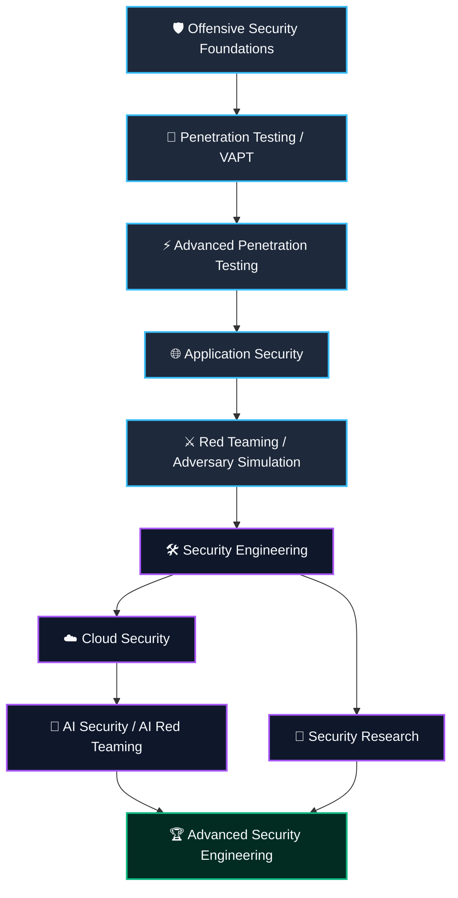
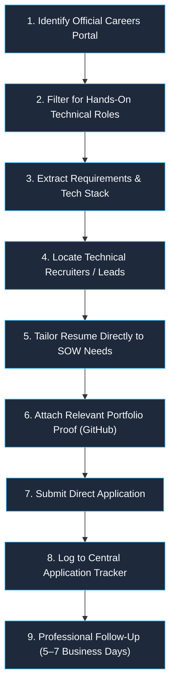
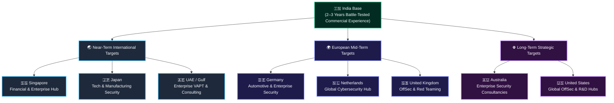
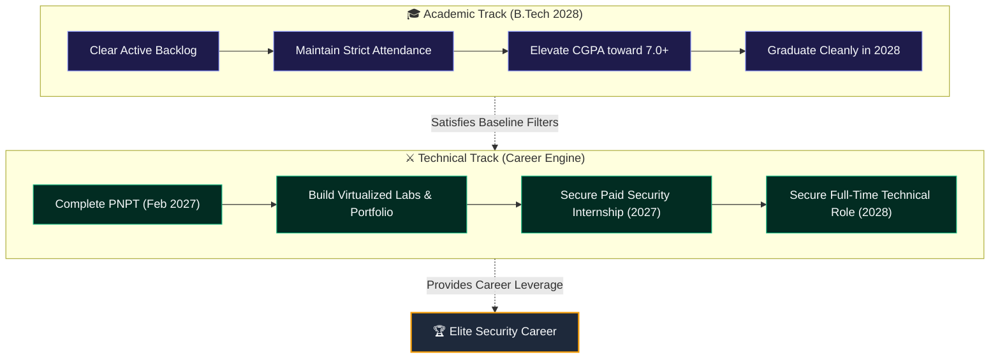
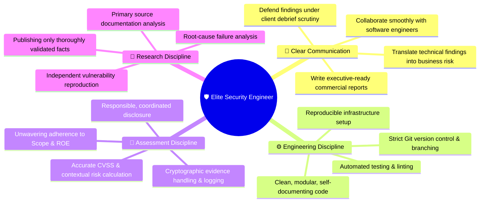

# 🛡️ Personal Technical & Professional Career Blueprint | 2026–2030+

> [!ABSTRACT] **Executive Vision**
> - **Primary Specialization:** Offensive Security *(VAPT → Advanced Penetration Testing → Red Teaming)*
> - **Long-Term Objective:** Elite Security Engineer with deep offensive security expertise
> - **Core Philosophy:** *Methodology over tools. Technical depth over superficial breadth. Demonstrable ability over certificates.*

---

## 📋 Blueprint Overview

|||
|---|---|
|🎯 **Primary Specialization**|Offensive Security *(VAPT → Advanced PenTesting → Red Teaming)*|
|🏗️ **Long-Term Objective**|Elite Security Engineer with deep offensive security expertise|
|🎓 **Academic Profile**|B.Tech Computer Engineering (2028) · DYPCOE, Akurdi, Pune|
|⚡ **Immediate Milestone**|PNPT Certification — Practical Network Penetration Tester (Feb 2027)|
|💼 **2027 Target**|Paid Offensive Security / VAPT Internship (India base)|
|🌐 **International Target**|Global Security Engineering & Red Teaming (2–3 years post-grad)|
|🧠 **Core Philosophy**|*Methodology over tools. Technical depth over superficial breadth. Demonstrable ability over certificates.*|

> [!NOTE] **Vault Cross-References**
> - 📅 **Active Prep:** [[PNPT - Planner (July 2026 - Feb 2027)|PNPT Study Planner]]
> - ⚔️ **Execution Manual:** [[PNPT-COMPLETE-ASSESSMENT-PLAYBOOK|PNPT Complete Assessment Playbook]]
> - 📚 **Foundations:** [[CSec-Learning-Path/PNPT-TCM-Cert-Notes/01-Practical Ethical Hacking (PEH)/01-Penetration Testing Fundamentals/00-INTRODUCTION|Practical Ethical Hacking Notes]]

---

## 📑 Table of Contents

1. [Career Direction](#1-career-direction)
   - 1.1 [The Destination](#11-the-destination)
   - 1.2 [Target Roles](#12-target-roles)
2. [Starting Position — November 2026](#2-starting-position--november-2026)
   - 2.1 [Education & Academic Strategy](#21-education)
   - 2.2 [Existing Technical Foundation](#22-existing-technical-foundation)
   - 2.3 [Professional Constraints & Preferences](#23-professional-constraints)
3. [The Fixed PNPT Preparation Schedule](#3-the-fixed-pnpt-preparation-schedule)
   - 3.1 [Certification Target](#31-certification-target)
   - 3.2 [Existing Monthly Schedule](#32-existing-monthly-schedule)
   - 3.3 [Non-Negotiable Preparation Principles](#33-non-negotiable-preparation-principles)
4. [Career Development Roadmap](#4-career-development-roadmap)
   - [Phase 1: PNPT & Professional Readiness (Nov 2026 – Feb 2027)](#phase-1--complete-pnpt-and-establish-professional-readiness)
   - [Phase 2: First Professional Experience (2027)](#phase-2--first-professional-experience)
   - [Phase 3: Advanced Offensive Security (Late 2027 – 2028)](#phase-3--advanced-offensive-security)
   - [Phase 4: Application Security & Security Engineering (2028 – 2029)](#phase-4--application-security-and-security-engineering)
   - [Phase 5: Cloud Security Engineering (2029 – 2030)](#phase-5--cloud-security-engineering)
   - [Phase 6: AI Security & AI Red Teaming (2029 Onward)](#phase-6--ai-security-and-ai-red-teaming)
   - [Phase 7: Advanced Red Teaming & Security Research (2030 Onward)](#phase-7--advanced-red-teaming-and-security-research)
5. [What Not to Over-Invest In](#5-what-not-to-over-invest-in)
6. [High-Value Technical Portfolio](#6-high-value-technical-portfolio)
7. [Employment Strategy](#7-employment-strategy)
   - 7.1 [India — First Professional Market](#71-india--first-professional-market)
   - 7.2 [International Target Organizations](#72-international-target-organizations)
8. [International Career Strategy](#8-international-career-strategy)
   - 8.1 [Geographic Priority](#81-geographic-priority)
   - 8.2 [Country Profiles](#82-singapore)
   - 8.7 [International Readiness Requirements](#87-international-readiness-requirements)
9. [Cybersecurity Employment Conditions (2026–2030)](#9-cybersecurity-employment-conditions--20262030)
10. [Academic and Professional Recovery](#10-academic-and-professional-recovery)
11. [GitHub, Resume, and LinkedIn Strategy](#11-github-resume-and-linkedin-strategy)
12. [Programming & Independent Technical Ability](#12-programming-and-independent-technical-ability)
13. [Professional Skills & Core Disciplines](#13-professional-skills)
14. [Consolidated Career Sequence (Master Timeline)](#14-consolidated-career-sequence)
15. [Milestones and Review Gates](#15-milestones-and-review-gates)
16. [Final Operating Principles](#16-final-operating-principles)
17. [Final Verdict](#17-final-verdict)

---

# 1. Career Direction

## 1.1 The Destination

My primary specialization is **Offensive Security**, with a long-term objective of becoming an advanced **Security Engineer** capable of understanding, assessing, exploiting, and securing complex systems.

I do not want to become someone who simply operates security tools. I want to understand the systems underneath them:
- Identify architectural and implementation weaknesses
- Construct resilient, multi-stage attack paths
- Validate and stress-test security assumptions
- Communicate technical findings and business risk professionally

### 🗺️ Evolution Sequence



> [!NOTE]
> This is a **long-term developmental vector**, not an obligation to hold every individual title in the diagram.

---

## 1.2 Target Roles

| Priority | Role | Purpose & Strategic Value |
|:---:|---|---|
| **P1** | 🎯 **Penetration Tester / VAPT Engineer** | First professional specialization · Build operational muscle |
| **P2** | 🌐 **Application Security Engineer** | Develop deep code-level, API, and architectural security expertise |
| **P3** | ⚔️ **Red Team Operator** | Progress into realistic, stealth-oriented adversary operations |
| **P4** | 🛠️ **Security Engineer** | Develop broader preventative and defensive engineering capabilities |
| **P5** | 🔬 **Security Researcher / Vulnerability Researcher** | Cultivate independent vulnerability discovery and reverse engineering |
| **P6** | ☁️ **Cloud Security Engineer** | Expand into cloud architecture, identity (Entra ID), and infrastructure |
| **P7** | 🤖 **AI Security Engineer / AI Red Teamer** | Specialize in emerging LLM, agentic system, and pipeline risks |

> [!IMPORTANT] **The Priority Rule**
> **Offensive Security remains the primary track.**  
> Cloud Security and AI Security are deliberate later-stage specializations — they must **never** become distractions during PNPT preparation or foundational offensive security mastery.

---

# 2. Starting Position — November 2026

## 2.1 Education

```
🎓 Degree:                 B.Tech Computer Engineering
🏛️ Institution:            Dr. D. Y. Patil College of Engineering, Akurdi, Pune
📅 Current Standing:       Third Year (Expected Graduation: 2028)
📊 Cumulative CGPA:        ~6.5 (through Semester 4)
⚠️ Active Backlog:         1
🎯 Academic Target:        Clear backlog · Elevate CGPA toward 7.0+
```

### 🧭 Academic Strategy

1. **Clear the active backlog** in the upcoming examination cycle.
2. **Maintain strict attendance** to avoid administrative penalties.
3. **Elevate cumulative CGPA** wherever realistically achievable across Semesters 5–8.
4. **Audit eligibility criteria** for company-specific cutoffs prior to applying.
5. **Decouple from on-campus dependency** — do not rely solely on college placements.
6. **Construct an independent off-campus pipeline** powered by demonstrable skill.

> [!TIP] **Academic Realism vs. Technical Reality**
> A lower CGPA can restrict eligibility for certain legacy corporate campus drives. It does **not** invalidate an offensive security career. Practical capability, verifiable internships, rigorous technical interviews, open-source projects, and field performance will be the decisive factors that overpower academic friction.

---

## 2.2 Existing Technical Foundation

### 📜 Training & Certifications

| Track / Credential | Status | Timeline / Target |
|---|:---:|---|
| **TCM Practical Ethical Hacking (PEH)** | `Completed` ✅ | 40+ hrs completed |
| **TCM OSINT Fundamentals** | `Completed` ✅ | Practical reconnaissance mastered |
| **PNPT Training (AD & EPP)** | `In Progress` 🔄 | Active study & lab runs |
| **TCM Linux Privilege Escalation** | `In Progress` 🔄 | Started — build commands cheatsheet |
| **Practical Network Penetration Tester (PNPT)** | `Target` 🎯 | **February 2027** |
| **OffSec Certified Professional (OSCP)** | `Future` ⏳ | Post-PNPT / 2027–2028 objective |

### 🛠️ Current Learning Platforms

- 🛡️ **TCM Security Academy** — Core PNPT curriculum & practical labs
- 🟩 **TryHackMe (Premium)** — Targeted networks (*Wreath*, *Holo*, privesc rooms)
- 🌐 **PortSwigger Web Security Academy** — Web application exploitation paths
- 💻 **Personal Virtualized Lab** — KVM/QEMU & VMware AD Windows domain forest
- 📝 **Obsidian Knowledge Vault** — Technical evidence, field notes, and playbooks

### 🔬 Technical Interests & Competencies

- Network penetration testing & pivoting
- Web application security & OWASP Top 10
- API security & authorization testing
- Active Directory enumeration & Kerberos abuse
- Linux & Windows local privilege escalation
- OSINT, reconnaissance, & attack surface mapping
- Internal network assessments & lateral movement
- Adversary emulation & red teaming
- Security tooling & automated reporting
- Vulnerability validation & root-cause research

---

## 2.3 Professional Constraints

| Area | Constraint / Preference | Strategic Implication |
|---|---|---|
| **Internship Model** | 💵 **Paid opportunities only** | Unpaid roles are non-negotiable rejections |
| **Primary Location** | 🇮🇳 **India** | Establish domestic credibility first |
| **Preferred City** | 📍 **Pune** (open to relocation) | Local preference, but flexible across major hubs |
| **Relocation Terms** | 🏢 **Any Indian tech hub** | Provided accommodation or compensation supports living |
| **Work Character** | 💻 **Hands-on technical work** | Practical testing, assessment, and architecture |
| **Company Profile** | 🛡️ **OffSec & pure-play security firms** | Prioritize specialized boutiques over general IT service desks |
| **Global Transition**| ✈️ **After 2–3 years professional exp** | Relocate with strong leverage, not as an unproven fresher |
| **Graduation Year** | 🎓 **2028** | Complete B.Tech while holding professional experience |
| **Immediate Objective**| 🚀 **Secure paid security work in 2027** | Convert PNPT credential into industry employment |

> [!IMPORTANT] **Boutique Firm Rule**
> A boutique security consultancy providing hands-on penetration testing, AD assessments, and client deliverables is infinitely superior to a prestigious multinational assigning you to routine ticket triage or non-technical compliance auditing.

---

# 3. The Fixed PNPT Preparation Schedule

> [!WARNING] **Sacred Baseline**
> **This schedule is the unshakeable foundation of the entire roadmap.**  
> Do not introduce competing learning tracks, new programming languages, or cloud tangents that jeopardize PNPT execution.

The existing [[PNPT - Planner (July 2026 - Feb 2027)|PNPT Study Planner]] remains the primary operational schedule.

## 3.1 Certification Target

|||
|---|---|
|🎯 **Certification**|**Practical Network Penetration Tester (PNPT)** — TCM Security|
|📅 **Prep Start**|July 15, 2026|
|📅 **Prep End**|January 31, 2027|
|🚨 **Exam Window**|**February 2027**|
|⏱️ **Format**|**5 Days** Practical Assessment + **2 Days** Commercial Report Writing|
|🎤 **Final Defense**|**15-minute Live Debrief** with TCM Security assessors|
|🔁 **Insurance**|1 Free retake included|

---

## 3.2 Existing Monthly Schedule

```
Jul 15 ──── Aug ──── Sep ──── Oct ──── Nov ──── Dec ──── Jan ──── Feb 2027
  │           │        │        │        │        │        │        │
 PEH        PEH      OSINT   Privesc   Labs    Full     Polish  🚨 EXAM
 Start     Finish   + EPP   Linux +   Grind   Mocks   + Rest   + Report
                            Windows                           + Debrief
```

| Month | Phase Focus | Required Measurable Outcome |
|---|---|---|
| **July 2026** | Practical Ethical Hacking (PEH) — Ignition | Attack VM, networking, scripting, enumeration methodology |
| **August 2026** | PEH Core & Active Directory Lab | PEH completion, multi-host AD lab built, mid-course capstone |
| **September 2026** | OSINT Fundamentals + External Playbook | OSINT methodology applied to bug bounties, external pentest process |
| **October 2026** | Linux & Windows Privilege Escalation | PrivEsc courses complete, 5+ THM/HTB boxes, personal cheatsheet |
| **November 2026** | Lab Practice, AD Simulations, Pivoting | *Wreath* network (pivoting), *Holo* (AD/AV), timed lab mock |
| **December 2026** | Full Mocks, Reporting & Debrief Drills | 2 end-to-end commercial reports drafted, mock debrief rehearsed |
| **January 2027** | Final Polish & Weak-Spot Remediation | Revision of weak links, toolkit freeze, mental rest, strategy check |
| **February 2027** | 🚨 **PNPT Examination** | **5-day assessment, professional report submission, live debrief** |

---

## 3.3 Non-Negotiable Preparation Principles

- [ ] **Follow the monthly & weekly planner** without unilateral adjustments.
- [ ] **Zero competing certifications** during this preparation sprint.
- [ ] **Zero competing deep-dives** into unrelated frameworks, languages, or cloud stacks.
- [ ] **No tool hoarding** — master the underlying protocol and manual execution first.
- [ ] **Evidence-first capture** — timestamp, full command syntax, host IP, and raw output.
- [ ] **Attack chain practice** — chain recon to foothold to privesc to domain compromise.
- [ ] **Commercial reporting standard** — treat the report as 50% of the exam grade.
- [ ] **Complete the exam first** before unlocking the next career phase.

> [!NOTE]
> **The immediate objective is PNPT readiness. Everything else must fit around it.**

---

# 4. Career Development Roadmap

The phases below represent the overarching career progression. They contextualize the post-PNPT journey without overwriting the fixed schedule.

---

## Phase 1 — Complete PNPT and Establish Professional Readiness

> [!ABSTRACT] **Phase 1 Profile**
> - **Timeline:** November 2026 – February 2027
> - **Primary Objective:** Convert training into an unshakeable, repeatable pentest methodology.

### 🎯 Why This Phase Matters
A certification is simply a validation mechanism. The true commercial outcome is your ability to conduct a structured engagement, capture unassailable evidence, map valid attack vectors, articulate business impact, and defend technical findings to executive assessors.

### 🔍 Primary Focus
- Maintain strict execution of the [[PNPT - Planner (July 2026 - Feb 2027)|PNPT Study Planner]].
- Consolidate field documentation in Obsidian using the [[PNPT-COMPLETE-ASSESSMENT-PLAYBOOK|PNPT Playbook]].
- Maintain clean, reproducible lab topologies.
- Standardize screenshot naming conventions and evidence archives.
- Prepare a clean, technical resume showcasing methodology over tools.
- Curate an initial list of target boutique security firms in India.

### 📦 Expected Outcome
- PNPT examination attempted and completed in February 2027.
- High-standard, professional penetration testing report produced.
- Confident, articulate performance during the live 15-minute debrief.
- Documented mastery of the complete security assessment lifecycle.
- Identified, cataloged list of technical edges to sharpen next.

### 🚪 Completion Gate
> [!CAUTION] **Video Completion ≠ Capability**
> Never consider this phase closed simply because course playlists show 100%. Completion requires:
> 1. Independent, tool-agnostic enumeration capability
> 2. Ability to uncover and validate realistic attack vectors
> 3. Flawless privilege escalation execution on Linux & Windows
> 4. Structured lateral movement across an Active Directory environment
> 5. Commercial-grade technical documentation and remediation advice
> 6. Crisp verbal explanation of findings under technical cross-examination

---

## Phase 2 — First Professional Experience

> [!ABSTRACT] **Phase 2 Profile**
> - **Timeline:** 2027
> - **Primary Objective:** Transition from controlled lab networks to production commercial security engagements.

### 🎯 Why This Phase Matters
Lab boxes are intentionally vulnerable; production enterprise environments are complex, noisy, fragile, and bound by strict legal contracts. This phase demystifies how real consultancy teams scope, execute, document, and remediate vulnerabilities.

### 🎯 Target Opportunities
1. 🛡️ Penetration Testing Intern
2. 🔍 VAPT Intern
3. ⚔️ Offensive Security Intern
4. 🌐 Application Security Intern
5. 🧪 Security Testing Intern
6. 📊 Junior Security Analyst *(strictly if hands-on technical assessment is core)*
7. 📋 Vulnerability Assessment Intern

### 🛠️ Technical Focus
- **External Network Assessments:** Perimeter mapping, exposed services, cloud storage leakage, credential stuffing
- **Internal Network Assessments:** Network segmentation bypass, LLMNR/NBT-NS poisoning, Kerberoasting, AS-REP roasting
- **Web App & API Testing:** Business logic flaws, IDORs, authentication bypasses, broken object-level authorization (BOLA)
- **Active Directory Testing:** ACL abuse, BloodHound path analysis, AD CS misconfigurations, unconstrained delegation
- **Privilege Escalation:** SUID, capabilities, scheduled tasks, unquoted service paths, token manipulation
- **Reporting & Remediation:** Translating CVEs into context-aware remediation roadmaps for clients

### 👔 Professional Skills
```
SOW Analysis ──► ROE Compliance ──► Scope Boundary Enforcement
      │
      ▼
Evidence Integrity ──► Impact-Exploitability Rating (CVSS) ──► Retesting Verification
      │
      ▼
Client Debriefs ──► Cross-Functional Dev/Infra Collaboration
```

### 💼 Internship Strategy
- **Absolute Requirement:** Paid compensation only.
- **Exposure Quality:** Real customer-facing assessments, not theoretical research papers.
- **Mentorship:** Daily proximity to senior penetration testers and security engineers.
- **Scope Variety:** Mix of external, internal, and web applications.

### 📦 Expected Outcome
- At least one substantial, paid professional internship or industry role completed in 2027.
- A battle-tested portfolio of sanitized, real-world assessment experiences.
- Intuitive comprehension of corporate testing boundaries and client communication.
- Clear technical clarity on whether to lean further toward VAPT, AppSec, or Red Teaming.

---

## Phase 3 — Advanced Offensive Security

> [!ABSTRACT] **Phase 3 Profile**
> - **Timeline:** Late 2027 – 2028
> - **Primary Objective:** Elevate from standard methodology execution to deep technical exploitation and stealth tradecraft.

### 🎯 Why This Phase Matters
Standard automated scanners and basic exploit scripts hit brick walls in hardened enterprise networks. Mastering manual exploitation, complex Active Directory trust exploitation, and evasive pivoting is what separates ordinary testers from elite operators.

### 🔍 Primary Focus
- Advanced Linux & Windows privilege escalation techniques
- Complex Active Directory attack paths (cross-forest trusts, PAM trust abuse)
- Enterprise identity abuse (AD CS ESC1–ESC8, Kerberos golden/silver tickets)
- Advanced network pivoting, multi-hop port forwarding, and traffic tunneling (Chisel, Ligolo-ng)
- Evasion concepts in authorized lab ranges (AMSI bypass, payload obfuscation fundamentals)
- Manual vulnerability discovery and exploit modification
- Attack path chaining across disparate technological domains
- Disciplined operational hygiene and minimal forensic footprinting

### 📜 Certification Trajectory

```
┌─────────────────────────────────┐       ┌─────────────────────────────────┐
│     PNPT (Foundational AD)      │  ──►  │     OSCP (Advanced OffSec)      │
│  TCM Security · February 2027   │       │  OffSec · Target 2027–2028      │
└─────────────────────────────────┘       └─────────────────────────────────┘
```

> [!TIP]
> OSCP is an industry benchmark for offensive credentials. Pursue it when your practical foundation is bulletproof. The goal is genuine engineering competence, not rote test memorization.

### 🔄 Practical Methodology Loop
```
1. Scope Analysis ──────► 2. OSINT/Recon ──────► 3. Deep Enumeration
       ▲                                                 │
       │                                                 ▼
10. Remediation ◄──── 9. Evidence Capture ◄──── 8. Post-Exploitation
       ▲                                                 │
       │                                                 ▼
 7. Lateral Movement ◄── 6. PrivEsc ◄── 5. Exploitation ◄── 4. Vuln ID
```

### 💼 Portfolio Targets
- 🏗️ Multi-domain Active Directory Attack Path Simulation Lab
- 📝 Exhaustive, sanitized Internal Network Assessment walkthrough
- ⚙️ Custom, independently written network enumeration or privilege analysis utility
- 📚 High-signal technical notes on complex attack vector mechanics

### 📦 Expected Outcome
By college graduation in 2028, hold competitive market standing for:
- Junior Penetration Tester
- VAPT Engineer
- Associate Application Security Engineer
- Security Testing Consultant
- Associate Red Team Operator

---

## Phase 4 — Application Security and Security Engineering

> [!ABSTRACT] **Phase 4 Profile**
> - **Timeline:** 2028 – 2029
> - **Primary Objective:** Bridge offensive testing with secure design, source code auditing, and security engineering.

### 🎯 Why This Phase Matters
Offensive skill reaches peak commercial value when paired with deep knowledge of how modern software is built, integrated, and hardened. Moving from *"breaking things"* to *"architecting unbreachable workflows"* establishes true long-term security engineering resilience.

### 🌐 Application Security Focus Areas
- **SDLC & Governance:** Secure Software Development Lifecycle (SSDLC) implementation
- **Threat Modeling:** STRIDE and PASTA threat modeling methodologies
- **Source Code Auditing:** Manual secure code review across modern web frameworks
- **IAM Architecture:** OAuth2, OIDC, SAML, session management, and JWT validation
- **API Hardening:** REST and GraphQL authorization architectures (preventing BOLA/BFLA)
- **Pipeline Automation:** SAST, DAST, SCA integration directly into CI/CD pipelines
- **Remediation Engineering:** Working directly with engineering squads to validate code-level patches

### 💻 Programming Languages & Tooling Focus

| Language | Primary Engineering Application |
|---|---|
| 🐍 **Python** | Security automation, testing frameworks, custom exploit harnesses |
| 🐚 **Bash** | Linux infrastructure scripting, operational auditing, log analysis |
| 🟨 **JavaScript** | Modern frontend analysis, DOM-based XSS, Node.js API auditing |
| 🔷 **Go** | High-performance, concurrent network tools and offensive utilities |
| ⚙️ **C / C++** | Systems programming, memory management, lower-level security mechanics |

> [!NOTE]
> Do not attempt to master all languages concurrently. Build competence organically through purpose-driven utilities and reproducible projects.

### 🚀 High-Value Project Targets
- 🛡️ **API Security Testing Framework** *(Automated endpoint inventory & authorization fuzzing)*
- 📑 **Pentest Report Automation Platform** *(Markdown-to-commercial deliverable engine)*
- 🔄 **Hardened CI/CD Pipeline Lab** *(GitHub Actions with automated security quality gates)*
- 🔍 **Source Code Security Review Lab** *(Intentionally vulnerable app with documented code fixes)*

### 📦 Expected Outcome
Achieve end-to-end Application Security maturity:
- Discover deep logic and architectural flaws via offensive testing
- Trace flaws directly to root-cause lines of code
- Architect practical, low-overhead remediation patterns
- Validate fixes programmatically and prevent regressions via automated pipeline checks

---

## Phase 5 — Cloud Security Engineering

> [!ABSTRACT] **Phase 5 Profile**
> - **Timeline:** 2029 – 2030
> - **Primary Objective:** Master cloud-native architecture, distributed identity, and enterprise cloud attack paths.

### 🎯 Why This Phase Matters
Modern enterprise perimeters are no longer defined by physical data centers. Identity is the new boundary. Mastering Microsoft Azure and cloud identity ecosystems connects on-premises Active Directory knowledge to modern enterprise infrastructure.

### ☁️ Primary Cloud Ecosystem
**Microsoft Azure & Microsoft Entra ID (Hybrid Identity Focus)**

### 📚 Systematic Learning Sequence
```
1. Cloud Architecture ──► 2. Azure Hierarchy ──► 3. Microsoft Entra ID
      │
      ▼
4. Identity & Access (RBAC/PIM) ──► 5. Service Principals & Managed Identities
      │
      ▼
6. Virtual Networks & NSGs ──► 7. Compute & Storage Hardening ──► 8. Key Vault Architecture
      │
      ▼
9. Logging & Telemetry ──► 10. Defender for Cloud ──► 11. Microsoft Sentinel (SIEM/SOAR)
      │
      ▼
12. Infrastructure as Code (Bicep/Terraform) ──► 13. Cloud Attack Path Graph Analysis
```

### ⚔️ Offensive Cloud Security Intersections
Assess and exploit realistic cloud attack vectors:
- Over-privileged RBAC roles and excessive service principal permissions
- Managed identity theft and token extraction from compute instances
- Misconfigured Azure Blob storage containers and exposed SAS tokens
- Cloud credential exposure in code repositories and deployment pipelines
- Network peering flaws and inadequate egress filtering
- Telemetry evasion and audit log disabling

### 🚀 High-Value Project Targets
- ☁️ **Azure Identity Attack Path Lab** *(Simulating Entra ID privilege escalation paths)*
- 📊 **Cloud Security Assessment Toolkit** *(Auditing subscription baseline configurations)*
- 🛡️ **Azure Sentinel Threat Detection Engine** *(Custom KQL rules detecting offensive actions)*

### 📦 Expected Outcome
Ability to audit, exploit, and architect resilient cloud environments from both adversary and engineering vantage points.

---

## Phase 6 — AI Security and AI Red Teaming

> [!ABSTRACT] **Phase 6 Profile**
> - **Timeline:** 2029 Onward
> - **Primary Objective:** Specialize in emerging attack surfaces surrounding LLMs, agentic workflows, and AI infrastructure.

### 🎯 Why This Phase Matters
As enterprises deploy autonomous agents, RAG pipelines, and LLM integrations, they create unprecedented attack surfaces. This specialization should be built **on top** of solid foundations in web application security, API design, and cloud infrastructure.

### 🤖 Primary Learning Areas
- **LLM Mechanics:** Transformer architectures, tokenization, embeddings, inference pipelines
- **Adversarial Prompting:** Direct prompt injection, multi-turn jailbreaking, system prompt extraction
- **Data & Retrieval Attacks:** Indirect Prompt Injection (IPI) via documents/web, RAG poisoning
- **Autonomous Agent Flaws:** Excessive agency, unauthenticated tool execution, insecure output handling
- **Infrastructure Vulnerabilities:** Vector database exposure, model serialization risks (pickle exploits)
- **Frameworks & Standards:** OWASP Top 10 for LLM Applications, MITRE ATLAS, NIST AI RMF

### ⚔️ Offensive AI Attack Surfaces


### 🚀 High-Value Project Targets
- 🧪 **LLM Red-Team Testing Workbench** *(Structured test suite for prompt & model attacks)*
- 📚 **RAG Pipeline Security Testing Lab** *(Document poisoning and context injection demos)*
- 🤖 **Agent Tool-Use Boundary Harness** *(Fuzzing autonomous agent execution scopes)*

### 📦 Expected Outcome
Elite domain authority in securing generative AI systems, anchored by true offensive and engineering depth.

---

## Phase 7 — Advanced Red Teaming and Security Research

> [!ABSTRACT] **Phase 7 Profile**
> - **Timeline:** 2030 Onward
> - **Primary Objective:** Execute full-scope adversary simulations, zero-day research, and strategic defense engineering.

### ⚔️ Primary Focus
- Full-scope adversary emulation based on threat intelligence (MITRE ATT&CK)
- Multi-tier stealth operations, custom C2 architecture, and egress filtering bypasses
- Complex enterprise identity graphs (hybrid AD + Entra ID synchronization)
- Collaborative Purple Team engagements (adversary emulation paired with SOC detection engineering)
- Independent vulnerability research, reverse engineering, and exploit development
- Coordinated responsible vulnerability disclosure (CVE generation)
- Engineering custom offensive tooling tailored for specialized operations

### 🏛️ Target Career Titles
- 🛡️ Senior Penetration Tester / Lead Security Consultant
- ⚔️ Senior Red Team Operator / Red Team Lead
- 🛠️ Senior Security Engineer (Offensive Security / AppSec)
- 🔬 Vulnerability Researcher / Security Researcher
- ☁️ Principal Cloud Security Engineer
- 🤖 Lead AI Security Engineer / AI Red Team Lead

---

# 5. What Not to Over-Invest In

> [!CAUTION] **High-Effort, Low-Yield Traps**
> Avoid these common industry traps that consume substantial cognitive bandwidth without generating proportional technical depth or career progress.

| ⚠️ Distraction / Trap | 💡 Rationale & Strategic Correction |
|---|---|
| **Hoarding Low-Tier Certifications** | Multiple generic multiple-choice certificates provide zero credibility. Prioritize grueling, hands-on, assessment-based credentials like PNPT and OSCP. |
| **Rote Tool Command Memorization** | Tools become obsolete; underlying protocols (SMB, Kerberos, HTTP, RPC) do not. Understand how the packet looks on the wire. |
| **Distro Hopping & Customization** | Constantly switching between Kali, Parrot, Arch, or customizing desktop themes is not technical development. Standardize and execute. |
| **Collector Mentality on Tools** | Cloning 500 GitHub tools creates clutter. Learn to operate with standard binaries and simple native utilities first. |
| **Excessive CTF Grinding** | Gamified CTFs often rely on unrealistic puzzle logic. Focus on realistic enterprise labs (AD forests, authentic network topologies). |
| **Abandoning Unfinished Projects** | Twenty half-finished script repos look amateurish. Ship 3–5 fully documented, production-ready, reproducible projects. |
| **Early Cloud & AI Distractions** | Jumping into cloud and AI security before mastering Linux, networking, web protocols, and identity will create superficial understanding. |
| **Total Dependence on AI Coding Agents** | Using AI without understanding every line of code destroys independent engineering ability. Code, debug, and understand your own tools. |
| **Social Media Noise Without Evidence** | Publishing commentary without technical substance builds hollow optics. Publish original field notes, architecture diagrams, and sanitized findings. |
| **Chasing Corporate Prestige Over Role** | A support role at a global giant is a career detour. A technical offensive role at a boutique firm builds career-defining muscle. |
| **Unpaid Internships** | Do not accept unpaid work under any circumstance. Authentic corporate deliverables command professional compensation. |
| **Treating Documentation as an Afterthought** | In commercial security, if it is not documented cleanly, the hack never happened. Technical writing is a primary engineering skill. |

---

# 6. High-Value Technical Portfolio

> [!TIP] **Portfolio Construction Strategy**
> Do not attempt to build all seven projects simultaneously. Build them progressively as you enter their corresponding career phases.

```
P1: OffSec Operating Environment (Phase 1)
                  │
                  ▼
P2: Active Directory Attack Path Lab (Phase 1–2)
                  │
                  ▼
P3: API Security Testing Framework (Phase 2–3)
                  │
                  ▼
P4: Pentest Report Automation Platform (Phase 3–4)
                  │
                  ▼
P5: Attack Surface Recon Dashboard (Phase 4)
                  │
                  ▼
P6: Cloud Identity Attack Path Lab (Phase 5)
                  │
                  ▼
P7: LLM Red-Team Testing Workbench (Phase 6)
```

---

### Project 1 — Offensive Security Operating Environment
- **Priority:** `High` 🔴 *(Immediate — Phase 1)*
- **Objective:** Design an engineered, fully reproducible penetration testing and documentation workstation.
- **Core Components:**
  - Standardized attack workstation setup (KVM/QEMU, Kali VM, network routing)
  - Pre-configured tooling suites (Impacket, NetExec, BloodHound, Burp Suite Pro/Community)
  - Strict directory and evidence management hierarchy
  - Automated bash provisioning scripts to deploy the environment from scratch
  - Structured Obsidian vault integration for rapid evidence logging during live tests

---

### Project 2 — Active Directory Attack Path Lab
- **Priority:** `High` 🔴 *(Phase 1–2)*
- **Objective:** Construct a fully virtualized, enterprise-grade Active Directory domain forest demonstrating real attack vectors.
- **Demonstrated Techniques:**
  - Multi-tier domain architecture (DC, domain workstations, dedicated services)
  - Initial access simulation via password spraying and AS-REP roasting
  - Kerberoasting, BloodHound graph path mapping, and ACL abuse
  - Constrained and unconstrained delegation exploitation
  - Pass-the-Hash, Overpass-the-Hash, and lateral movement
  - Local and domain privilege escalation ending in Domain Admin takeover
  - Complete accompanying documentation explaining both exploit mechanics and Group Policy hardening fixes

---

### Project 3 — API Security Testing Framework
- **Priority:** `High` 🔴 *(Phase 2–3)*
- **Objective:** Develop a Python-based utility engineered for authorized API reconnaissance, fuzzing, and authorization auditing.
- **Core Capabilities:**
  - Automated OpenAPI/Swagger specification parsing and endpoint map generation
  - Multi-role authorization testing (detecting BOLA / IDOR vulnerabilities automatically)
  - Parameter tampering and unexpected data type injection
  - Security header analysis and rate-limit evaluation
  - Structured JSON and Markdown evidence output designed for commercial reports

---

### Project 4 — Pentest Report Automation Platform
- **Priority:** `High` 🔴 *(Phase 3–4)*
- **Objective:** Create a streamlined reporting engine that transforms raw markdown notes and JSON evidence into commercial-grade PDF/HTML assessment reports.
- **Core Capabilities:**
  - Standardized finding database (CWE, CVSS 3.1 scoring, remediation templates)
  - Automated inclusion of terminal logs, screenshots, and proof-of-concept steps
  - Dynamic generation of executive risk summaries and technical vulnerability tables
  - Modular templating engine supporting custom agency branding and executive formatting

---

### Project 5 — Attack Surface Reconnaissance Dashboard
- **Priority:** `Medium` 🟡 *(Phase 4)*
- **Objective:** Develop a continuous external asset discovery and exposure tracking dashboard.
- **Core Capabilities:**
  - Automated subdomain enumeration and DNS resolution chaining
  - Port scanning integration and HTTP service fingerprinting
  - Cloud storage bucket detection and TLS certificate analysis
  - Change-tracking alerts when new external assets appear in-scope

---

### Project 6 — Cloud Identity Attack Path Lab
- **Priority:** `Later Stage` ⏳ *(Phase 5)*
- **Objective:** Build an Azure/Entra ID simulation proving hybrid identity vulnerability paths.
- **Core Capabilities:**
  - Misconfigured RBAC roles and excessive application permissions
  - Managed identity credential exfiltration from virtual machines
  - Service principal abuse and privilege escalation to Global Administrator
  - Accompanying Azure Sentinel detection rules (KQL) mapping the attack chain

---

### Project 7 — LLM Red-Team Testing Workbench
- **Priority:** `Later Stage` ⏳ *(Phase 6)*
- **Objective:** Build an automated evaluation suite to stress-test LLM applications and agent pipelines.
- **Core Capabilities:**
  - Test suites for direct and indirect prompt injection
  - Insecure output handling and cross-site scripting via model outputs
  - Autonomous agent permission boundary violation harnesses
  - Benchmarked reporting against OWASP Top 10 for LLM Applications

---

# 7. Employment Strategy

## 7.1 India — First Professional Market

The primary gateway is securing a high-yield, paid technical internship or associate role in India during 2027.

### 🎯 Target Role Categories
- VAPT Intern
- Penetration Testing Intern
- Offensive Security Intern
- Application Security Intern
- Junior Penetration Tester
- Associate VAPT Consultant

---

### 🏢 Target Organizations in India

> [!NOTE]
> These represent curated organizations with established security teams and active client engagements in India.

| Category | Organization | Area of Security Practice |
|---|---|---|
| **Pure-Play OffSec Consultancies** | **SecureLayer7** | Web app, API, and cloud penetration testing |
| | **AppSecure** | Application security and vulnerability assessment |
| | **Kratikal** | Network and enterprise security assessments |
| | **Aujas Cybersecurity** | Identity security and comprehensive enterprise testing |
| | **SISA** | Payment security (PCI-DSS), auditing, and pentesting |
| | **TAC Security** | Enterprise vulnerability management |
| **Product & Enterprise Security** | **Quick Heal / Seqrite** | Endpoint security, threat research, and red teaming |
| | **Safe Security** | Enterprise cyber risk quantification |
| | **Qualys** | Cloud vulnerability management and VMDR systems |
| **Global Security Hubs (India Offices)** | **Palo Alto Networks** | Network, cloud, and next-gen firewall security |
| | **CrowdStrike** | Threat intelligence, incident response, and OffSec |
| | **Rapid7** | Metasploit maintenance, vulnerability research, and pentesting |
| | **Cisco** | Enterprise network, VPN, and infrastructure security |
| | **Cloudflare** | Edge network security and DDoS mitigation |
| | **Microsoft** | Platform security and cloud engineering |

---

### 📝 Systematic 9-Step Direct Application Framework



> [!TIP]
> Do not rely exclusively on one-click applications on LinkedIn or generic job boards. Direct, targeted outreach with demonstrable GitHub evidence yields far higher interview conversion rates.

---

## 7.2 International Target Organizations

After building 2–3 years of verifiable commercial experience in India, target world-tier offensive security teams:

| Organization | Core Strength & Technical Specialization |
|---|---|
| 🦊 **Bishop Fox** | High-end offensive security, red teaming, and adversary emulation |
| 🛡️ **NCC Group** | Elite global security consulting, crypto audits, and research |
| 🎯 **Synack** | Crowdsourced offensive testing and vetted research operations |
| 🦅 **CrowdStrike** | Cutting-edge threat research, adversary emulation, and forensics |
| 🌐 **Palo Alto Networks** | Unit 42 research, threat hunting, and infrastructure assessment |
| ⚡ **Rapid7** | Premier offensive security consulting and exploit research |
| 🔍 **Google / Mandiant** | World-leading threat intelligence, red teaming, and incident response |
| ☁️ **Cloudflare** | Distributed systems security, edge engineering, and research |
| 💻 **Microsoft** | Azure security engineering, internal red team, and MSRC |
| 🔧 **Cisco** | Core network infrastructure, Talos intelligence, and hardware research |

---

# 8. International Career Strategy

## 8.1 Geographic Priority

The international transition begins after accumulating 2–3 years of verifiable commercial security experience in India:



---

## 8.2 Singapore
- **Target Sectors:** Financial services penetration testing, product security, cloud security engineering
- **Key Considerations:** Employment Pass (EP) salary thresholds, strict qualification vetting, high demand for certified penetration testers (PNPT/OSCP).

## 8.3 Japan
- **Target Sectors:** Enterprise penetration testing, manufacturing security, hardware/embedded security research
- **Key Considerations:** Japanese language proficiency (JLPT N2/N1) dramatically expands opportunities. Begin language studies only when it does not compromise core technical preparation.

## 8.4 UAE
- **Target Sectors:** Large-scale VAPT consulting, enterprise red teaming, critical infrastructure defense
- **Key Considerations:** Rapidly growing market with attractive tax incentives; prioritize roles based on technical depth and growth over raw salary alone.

## 8.5 Germany, Netherlands, and United Kingdom
- **Target Sectors:** Product security engineering, AppSec, boutique penetration testing consultancies
- **Key Considerations:** Work permit sponsorship regulations, local language preferences (Germany), high technical interview standards, cost of living vs. net savings.

## 8.6 Australia and United States
- **Target Sectors:** Cutting-edge offensive security, security research, global tech companies
- **Key Considerations:** Strict visa regulations (H-1B, TSS 482); national security roles frequently mandate local citizenship or defense clearances. Focus strictly on commercial private-sector entities.

---

## 8.7 International Readiness Requirements

Before initiating international applications, ensure the following checklist is completely fulfilled:

- [ ] **2–3 years of full-time, verifiable professional security experience**
- [ ] **Strong technical references and endorsements from senior colleagues**
- [ ] **Documented track record of successful enterprise assessments**
- [ ] **A clean, compelling GitHub portfolio with well-documented tools**
- [ ] **Commercial-grade report writing and technical writing samples**
- [ ] **Polished English communication and client presentation ability**
- [ ] **Recognized practical certifications (PNPT, OSCP, Azure/Cloud credentials)**
- [ ] **Independent technical problem-solving ability proven through research**
- [ ] **Thorough understanding of target country immigration and visa requirements**

---

# 9. Cybersecurity Employment Conditions — 2026–2030

## 9.1 India Market Realities
India's cybersecurity industry continues to expand, but headlines regarding a *"talent shortage"* can be misleading. There is a surplus of individuals with theoretical certificates; there is a severe shortage of engineers with genuine, hands-on, problem-solving ability.

Employers aggressively screen for:
- Hands-on assessment capability that functions without commercial GUI scanners
- Fundamental comprehension of networking protocols and operating system internals
- Clear, professional verbal communication and client-ready report writing
- Independent problem-solving and troubleshooting under pressure
- Deep respect for client scope, rules of engagement, and legal boundaries

---

## 9.2 International Market Realities
The international job market fluctuates based on macroeconomic cycles, venture capital funding, and regional regulations:
- High demand persists for practitioners who can prove immediate ROI (e.g., stopping active breaches, uncovering critical vulnerabilities before launch).
- Fresh graduates face heavy friction due to visa sponsorship costs and legal residency requirements.
- The **India-first strategy** (building 2–3 years of commercial credibility domestically) effectively mitigates entry-level immigration barriers.

---

## 9.3 AI and Changing Entry-Level Work
Automation and AI agents are rapidly absorbing surface-level security tasks:
- Simple automated vulnerability scanning is fully commoditized.
- Basic boilerplate reporting is increasingly assisted by language models.

### 🛡️ How to Remain Irreplaceable
To maintain long-term competitive advantage, build skills that automated models cannot reliably execute:
1. **System Internals:** Deep understanding of OS kernels, memory models, and networking protocols
2. **Multi-Stage Attack Chaining:** Connecting subtle, low-severity misconfigurations into high-impact compromise paths
3. **Complex Business Logic Flaws:** Uncovering architectural bugs that require nuanced business domain comprehension
4. **Manual Exploitation & Tool Engineering:** Building custom payloads and bespoke testing harnesses
5. **Human Adversary Simulation:** Thinking like a persistent threat actor under active defensive pressure

---

## 9.4 Authoritative Research Sources

Monitor these benchmarks periodically to re-calibrate career decisions against macro data:
- [DSCI — Indian Cyber Security Skilling Landscape](https://www.dsci.in/resource/content/indian-cyber-security-skilling-landscape-2025-2026)
- [ISC2 — India Cybersecurity Workforce Research](https://www.isc2.org/Insights/2026/09/research-india-cybersecurity-workforce-reaches-a-turning-point-skills-ai)
- [SANS — Cybersecurity Workforce Research Report](https://www.sans.org/white-papers/2026-cybersecurity-workforce-research-report)
- [UK Government — Cyber Security Skills in the UK Labour Market](https://www.gov.uk/government/publications/cyber-security-skills-in-the-uk-labour-market-2026/cyber-security-skills-in-the-uk-labour-market-2026)

---

# 10. Academic and Professional Recovery

> [!IMPORTANT] **The Dual-Track Model**
> Academic credentials open initial screening filters; technical competence wins interviews and builds the career. Maintain both tracks diligently without letting either cannibalize the other.



### Actionable Academic Priorities
1. **Eliminate the active backlog immediately** in the earliest scheduled examination window.
2. **Elevate CGPA toward 7.0+** to bypass rigid automated applicant screening thresholds.
3. **Preserve attendance buffers** to eliminate unnecessary academic stress during exam seasons.
4. **Target security firms with merit-based hiring** that evaluate practical capability over academic cutoffs.
5. **Never misrepresent or falsify academic credentials** on resumes or job applications.

---

# 11. GitHub, Resume, and LinkedIn Strategy

## 11.1 GitHub: Your Engineering Portfolio

Your GitHub profile is tangible proof of your technical competence. Avoid empty forks or shallow repository hoarding.

### 📐 Principles of High-Signal Repositories
- **Original Code & Automation:** Custom utilities, assessment tools, and testing harnesses
- **Exhaustive Documentation:** Clean `README.md` files with clear installation and usage guides
- **Reproducible Setup:** Dockerfiles, Vagrantfiles, or automated setup scripts
- **Architectural Diagrams:** Clear data-flow and threat-model visuals
- **Meaningful Git History:** Granular, descriptive commit messages demonstrating iterative development

### ❓ The 7 Core Repository Questions
Every portfolio repository must answer:
1. *What specific problem does this utility address?*
2. *Why does this problem matter in commercial security?*
3. *How is the system architected underneath?*
4. *How does it execute step-by-step?*
5. *How can another security engineer reproduce and test it?*
6. *What are its technical boundaries and limitations?*
7. *What engineering insights were gained while building it?*

---

## 11.2 Resume: Factual, Impact-Driven Positioning

> [!NOTE]
> Keep your resume factual, concise, and focused on verifiable technical competencies.

- **Lead with Practical Training:** Highlight TCM Security courses, PNPT candidate status, and hands-on lab miles.
- **Accurately Label In-Progress Items:** Explicitly denote certifications in-progress (e.g., *PNPT Candidate — Target: Feb 2027*).
- **Detail Technical Projects:** Showcase architecture, programming languages, and specific security mechanisms implemented.
- **Quantify Assessment Capabilities:** Explicitly list methodologies (Active Directory attack chains, OWASP Top 10, OSINT, privilege escalation).
- **Eliminate Empty Buzzwords:** Delete unsubstantiated claims like *"Cybersecurity Expert"* or *"Master Hacker"*. Let project depth demonstrate skill.

---

## 11.3 LinkedIn: Builder, Not Commentator

Position yourself on professional networks as a **serious technical builder**:

```
                              THE LINKEDIN FRAMEWORK
                    ┌─────────────────────────────────────────┐
                    │      BUILDER, NOT COMMENTATOR           │
                    └─────────────────────────────────────────┘
                                         │
        ┌────────────────────────────────┼────────────────────────────────┐
        ▼                                ▼                                ▼
┌───────────────────────┐  ┌───────────────────────────┐  ┌───────────────────────────────┐
│  Technical Field Notes│  │ Project Engineering Logs  │  │ Lab Findings & Methodologies  │
│  Deep technical dives │  │ Real code and tool builds │  │ Sanitized proof-of-concepts   │
└───────────────────────┘  └───────────────────────────┘  └───────────────────────────────┘
```

- **Publish Technical Insights:** Post concise breakdowns of tricky privilege escalation vectors, AD trust mechanics, or API authorization bugs.
- **Share Project Milestones:** Post code snippets, architecture diagrams, and release notes for your GitHub projects.
- **Avoid Superficial Engagement:** Refrain from resharing low-quality reposts, generic advice threads, or celebration posts for unearned accomplishments.

---

# 12. Programming and Independent Technical Ability

> [!IMPORTANT] **Engineering Independence**
> An elite security engineer writes, debugs, and understands code independently. AI tools may assist with syntax or routine scaffolding, but they must **never** replace your fundamental understanding of logic, memory, and algorithms.

## 12.1 Language Matrix & Focus Areas

| Language | Primary Focus & Security Domain | Core Libraries / Utilities |
|---|---|---|
| 🐍 **Python** | Assessment automation, API testing, prototype exploits, data parsing | `requests`, `impacket`, `socket`, `scapy`, `asyncio` |
| 🐚 **Bash** | Linux operational automation, log parsing, environment provisioning | `awk`, `sed`, `grep`, `systemd`, `cron` |
| 🟨 **JavaScript** | Web app vulnerabilities, DOM auditing, API request inspection | Node.js, Express, browser devtools, Fetch API |
| 🔷 **Go** | High-performance network scanners, concurrent tools, cross-compilation | `net`, `http`, `goroutines`, `channels` |
| ⚙️ **C / C++** | Memory models, OS internals, reverse engineering, exploit mechanics | Win32 API, POSIX, pointers, memory allocation |

---

## 12.2 The 8-Step Independent Learning Loop

```
1. Concept Deconstruction ──► 2. Standalone Code Implementation ──► 3. Unit & Edge Testing
                                                                            │
                                                                            ▼
6. Read Production Code ◄── 5. Refactor & Optimize ◄── 4. Manual Debugging (Zero AI)
           │
           ▼
7. Build Security Utility ──► 8. Publish Technical Documentation
```

---

# 13. Professional Skills

Technical ability is merely the engine; professional discipline is the steering wheel. Long-term leadership requires four foundational pillars:



---

# 14. Consolidated Career Sequence

A unified timeline coordinating academic requirements, certification checkpoints, employment stages, and long-term specializations:

| Timeline | Primary Career Objective | Key Target Outcomes |
|---|---|---|
| **Nov 2026 – Jan 2027** | Fixed PNPT Preparation Sprint | Complete AD labs, privilege escalation courses, and mock assessments |
| **February 2027** | 🚨 **PNPT Certification Exam** | **5-day assessment, professional report submission, live debrief pass** |
| **Spring – Summer 2027**| First Professional Employment | Secure paid VAPT / OffSec internship in India; build initial client hours |
| **Late 2027 – 2028** | Advanced OffSec & OSCP Preparation | Deepen Active Directory tradecraft; tackle OSCP challenge labs |
| **2028** | B.Tech Graduation & Full-Time Role | Clear backlog, complete degree, transition into junior penetration tester role |
| **2028 – 2029** | AppSec & Security Engineering | Code auditing, threat modeling, API testing, secure CI/CD pipelines |
| **2029 – 2030** | Azure & Cloud Security Engineering | Entra ID architecture, cloud attack paths, Sentinel detection engineering |
| **2029 Onward** | AI Security & AI Red Teaming | LLM red teaming, agent safety boundary testing, OWASP Top 10 for LLMs |
| **2030 Onward** | Advanced Red Teaming & Research | Full-scope adversary emulation, vulnerability research, global relocation |

---

# 15. Milestones and Review Gates

Use this checklist during periodic retrospective reviews. Progress is measured by demonstrated competency, not time spent reading.

### 🏁 February 2027 — PNPT Milestone
- [ ] 5-day practical assessment executed strictly within scope
- [ ] Commercial-grade penetration testing report delivered on schedule
- [ ] Live 15-minute technical debrief successfully defended
- [ ] Technical strengths and post-exam skill gaps documented in Obsidian
- [ ] Resume and LinkedIn updated with verified PNPT credential

### 🏁 Mid-2027 — Professional Industry Entry
- [ ] Secured a paid cybersecurity internship in India (VAPT/PenTesting/AppSec)
- [ ] Published at least one major, documented GitHub portfolio project
- [ ] Active academic backlog cleared or clear exam path confirmed
- [ ] Structured technical assessment log maintained for all practical work

### 🏁 End of 2027 — Operational Consolidation
- [ ] Completed first commercial internship with positive mentor references
- [ ] Advanced offensive security practice sustained (Active Directory / OSCP labs)
- [ ] GitHub portfolio expanded with custom security automation utilities
- [ ] Full-time job applications prepared for post-graduation deployment

### 🏁 2028 — Graduation & Full-Time Security Role
- [ ] B.Tech Computer Engineering successfully completed
- [ ] Cumulative CGPA stabilized/improved toward 7.0+
- [ ] Full-time Penetration Tester or Application Security Engineer role secured
- [ ] Independent offensive methodology demonstrated across network and web targets

### 🏁 2029 — Security Engineering Maturation
- [ ] Active involvement in application security reviews and CI/CD security automation
- [ ] Microsoft Azure & Entra ID hybrid identity security mastered
- [ ] Initial international market research initiated (visa, language, and role prerequisites)

### 🏁 2030 — Elite Specialization & Global Horizon
- [ ] Cloud security assessment capability fully established
- [ ] Practical AI Red Teaming methodologies operationalized
- [ ] Specialized direction selected (Advanced Red Teaming vs. Security Engineering vs. Research)
- [ ] International relocation applications submitted backed by 2–3 years of commercial proof

---

# 16. Final Operating Principles

> [!ABSTRACT] **The 13 Core Tenets**
> 1. **PNPT comes first.** Never compromise the existing preparation schedule with shiny distractions.
> 2. **Offensive Security is the home base.** Every adjacent domain (Cloud, AppSec, AI) must enhance your offensive foundation, not dilute it.
> 3. **Methodology beats tool familiarity.** Tools expire; attack methodology, system understanding, and protocol mechanics are permanent.
> 4. **Practical execution beats certification collecting.** Real, hands-on ability is the only credential that survives a technical interview.
> 5. **Build fewer, deeper engineering projects.** Ship three polished, reproducible, well-documented tools over thirty superficial scripts.
> 6. **Master the systems you assess.** You cannot thoroughly exploit or defend what you do not understand.
> 7. **Retain independent programming ability.** Write your own tools. Never become dependent on automated generators for basic code logic.
> 8. **Commercial reporting is a core technical skill.** The hack means nothing if the client cannot understand or remediate the vulnerability.
> 9. **Demand paid industry experience before graduation.** Practical commercial experience is the ultimate differentiator for an entry-level candidate.
> 10. **Build a solid launchpad in India.** Establish 2–3 years of verifiable commercial credibility domestically before pursuing global moves.
> 11. **Pursue international roles from a position of strength.** Enter the global market with proven commercial deliverables, not as an unproven applicant.
> 12. **Master the fundamentals before touching Cloud or AI security.** Advanced specializations require rock-solid operating system and networking foundations.
> 13. **Review this roadmap periodically, but never pivot impulsively.** Consistent, disciplined execution of a single strategy will always outperform chronic directional shifting.

---

# 17. Final Verdict

The immediate objective is **not** to become proficient in every security domain simultaneously.

The immediate objective is to become an **exceptional penetration tester**, conquer the **PNPT**, enter the industry through **paid commercial experience**, and build an **unshakeable offensive security foundation**.

Once established, deepen that tradecraft into advanced penetration testing, application security, and adversary emulation. From there, expand strategically into Security Engineering, Azure Cloud Architecture, and AI Red Teaming.

```
┌──────────────────────────────────────────────────────────────────┐
│                   THE PROGRESSION LADDER                         │
│                                                                  │
│  PNPT (Feb 2027)                                                 │
│    │                                                             │
│    ▼                                                             │
│  Paid Commercial Experience (2027)                               │
│    │                                                             │
│    ▼                                                             │
│  Advanced Offensive Security & OSCP (2027–2028)                  │
│    │                                                             │
│    ▼                                                             │
│  Application Security & Software Hardening (2028–2029)           │
│    │                                                             │
│    ▼                                                             │
│  Red Teaming & Adversary Emulation (2029)                        │
│    │                                                             │
│    ▼                                                             │
│  Security Engineering & Azure Cloud Defense (2029–2030)          │
│    │                                                             │
│    ▼                                                             │
│  AI Security & Autonomous Agent Red Teaming (2029+)              │
│    │                                                             │
│    ▼                                                             │
│  Advanced Security Research & Global Engineering (2030+)         │
└──────────────────────────────────────────────────────────────────┘
```

> [!QUOTE] **The Core Mandate**
> **The ultimate objective is to become an engineer who understands how systems fail, how attackers exploit them, how defenders detect those attacks, and how resilient systems must be engineered from the ground up.**
>
> *Build the fundamentals. Master the methodology. Gain real experience. Then specialize.*

---

*Roadmap Formulated: November 2026*  
*Academic Target: B.Tech Computer Engineering — 2028 (DYPCOE, Pune)*  
*Immediate Certification Target: PNPT — February 2027*  
*Primary Specialization: Offensive Security*  
*Long-Term Direction: Advanced Security Engineering*