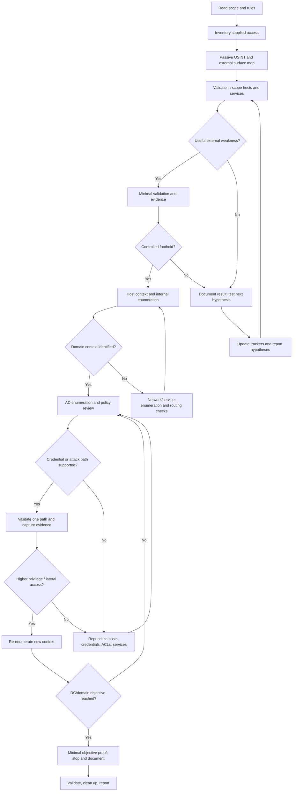
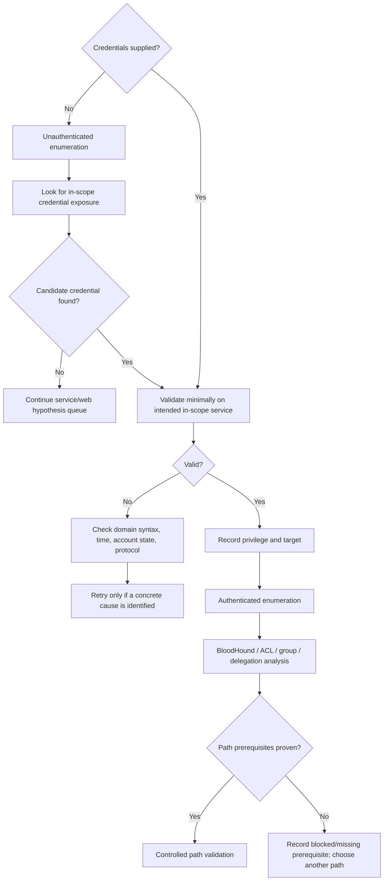
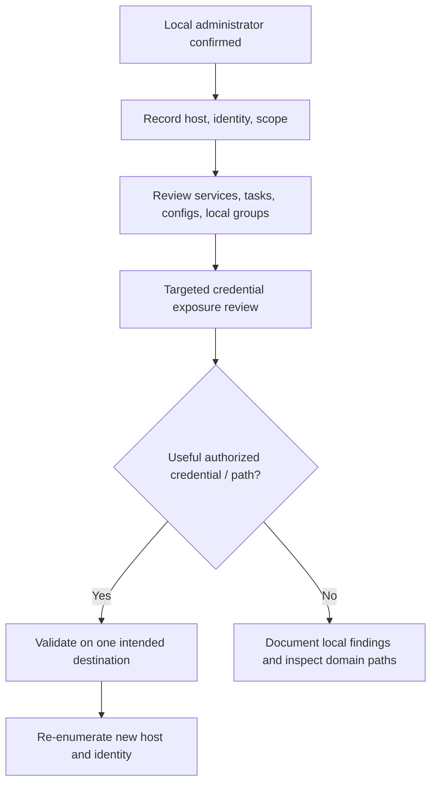
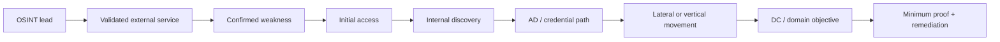

# PNPT Complete Assessment Playbook
> **Personalized field manual | External + Internal Penetration Test | 5 practical days + 2 report days**
>
> **Purpose:** A decision-oriented checklist for an authorized PNPT-style assessment, from first scope review through the live 15-minute debrief. This is a workflow, not a claim about the exam's topology or guaranteed attack paths.

**Version:** 1.0  
**Prepared:** 2026-10-19  
**Primary operator environment noted in prior planning:** Ubuntu host → KVM/QEMU → Kali Linux VM; Chromium/Burp Suite; NetExec, Impacket, BloodHound, Chisel; Markdown evidence workspace. Verify these details against the environment actually available on exam day.

---

## Operating principles

- **Scope before action.** Use only supplied scope, approved targets, and authorized techniques. Do not infer that a discovered system is in scope.
- **Enumerate before exploiting.** Every exploit attempt should have a reason, a target, a hypothesis, and a stop condition.
- **Evidence as you go.** A screenshot, command output, timestamp, host, account context, and reproducible steps are more valuable than a memory of what happened.
- **Prove impact proportionately.** Avoid destructive actions, unnecessary data access, persistence, and uncontrolled credential dumping. Stop once the objective is convincingly demonstrated.
- **No assumed starting point.** Credentials, VPN access, initial foothold, domains, hosts, and attack paths may or may not be supplied. Record what was provided separately from what you discover.
- **Label certainty.** Separate confirmed facts, inferred hypotheses, failed tests, and untested possibilities.
- **Use this playbook as a map.** A phase is not a mandatory attack list. Skip inapplicable techniques and record why.

> **Source transparency:** The workspace/library search surfaced general cybersecurity artifacts and a separate `MASTER PROMPT.md`, but did not surface a dedicated PNPT notes vault or command-reference document containing your full OSINT/enum/AD/privilege-escalation procedures. This playbook therefore combines known context from prior PNPT planning (Kali VM, Burp, NetExec, Impacket, BloodHound, Chisel, evidence-first reporting) with clearly labelled supplemental methodology. It does **not** claim that every command below was present in your original notes. Add links to your own Obsidian note paths in the reference fields as you reconcile them.

## Status legend

- `[ ]` Not started
- `[x]` Completed with evidence saved
- `[~]` Attempted / partial / needs follow-up
- `[!]` Blocked, unsafe, out of scope, or awaiting authorization
- **Conditional** means perform only when prerequisites and rules of engagement support it.

---

## Clickable table of contents

1. [Quick start](#quick-start)
2. [Phase 00 — Pre-engagement preparation](#phase-00--pre-engagement-preparation)
3. [Phase 01 — OSINT assessment](#phase-01--osint-assessment)
4. [Phase 02 — External network reconnaissance](#phase-02--external-network-reconnaissance)
5. [Phase 03 — External exploitation](#phase-03--external-exploitation)
6. [Phase 04 — Internal network enumeration](#phase-04--internal-network-enumeration)
7. [Phase 05 — Active Directory enumeration](#phase-05--active-directory-enumeration)
8. [Phase 06 — Credential attacks](#phase-06--credential-attacks)
9. [Phase 07 — Initial access and foothold](#phase-07--initial-access-and-foothold)
10. [Phase 08 — Local privilege escalation](#phase-08--local-privilege-escalation)
11. [Phase 09 — AD privilege escalation](#phase-09--ad-privilege-escalation)
12. [Phase 10 — Lateral movement and pivoting](#phase-10--lateral-movement-and-pivoting)
13. [Phase 11 — Antivirus and egress assessment](#phase-11--antivirus-and-egress-assessment)
14. [Phase 12 — Domain Controller compromise](#phase-12--domain-controller-compromise)
15. [Phase 13 — Post-exploitation, validation, cleanup](#phase-13--post-exploitation-validation-cleanup)
16. [Phase 14 — Professional reporting](#phase-14--professional-reporting)
17. [Phase 15 — Live technical debrief](#phase-15--live-technical-debrief)
18. [Decision trees](#decision-trees)
19. [Five-day practical tracker](#five-day-practical-tracker)
20. [Two-day report tracker](#two-day-report-tracker)
21. [Working trackers and templates](#working-trackers-and-templates)
22. [Blocked-path troubleshooting](#blocked-path-troubleshooting)
23. [Quick command reference](#quick-command-reference)
24. [Readiness gaps and note reconciliation](#readiness-gaps-and-note-reconciliation)

---

# Quick start

## First 15 minutes

- [ ] Read the rules of engagement, scope, exclusions, prohibited actions, and reporting instructions.
- [ ] Confirm VPN/interface and route; record assigned IP and time zone.
- [ ] Create the workspace and evidence folders (Phase 00).
- [ ] Inventory supplied domains, IP ranges, URLs, usernames, passwords, files, and access methods.
- [ ] Label each item **SUPPLIED**, **DISCOVERED**, **VALIDATED**, or **UNCONFIRMED**.
- [ ] Start a timestamped activity log.
- [ ] Begin passive OSINT and broad attack-surface mapping only within approved scope.
- [ ] Maintain a live hypothesis queue: *observation → hypothesis → safe test → result → next step*.

## Universal loop

1. **Observe** — collect the smallest useful set of facts.
2. **Interpret** — explain what the facts imply and what they do not prove.
3. **Prioritize** — likelihood × impact × confidence × time cost.
4. **Test** — run one controlled, scoped test.
5. **Validate** — distinguish a real weakness from a scanner guess.
6. **Capture** — save evidence immediately.
7. **Branch** — follow the result-based next step or mark the path blocked.
8. **Report** — draft the finding while the details are fresh.

---

# Phase 00 — Pre-Engagement Preparation

**Objective:** Establish authorized boundaries, working access, repeatable evidence collection, and a usable workspace before active testing.

### Scope, access, and safety

- [ ] Record every in-scope domain, CIDR, IP, URL, tenant, and environment.
  - **Prerequisite:** Exam instructions / scope statement.
  - **Observe:** Explicit target list, exclusions, time limits, prohibited actions.
  - **Next:** Maintain a target allowlist; do not expand scope based on DNS or routing alone.
  - **Evidence:** Scope snapshot or transcription with source and timestamp.
  - **Reference:** `[[PNPT - Rules of Engagement]]` *(verify/add your Obsidian path)*.
- [ ] Record rules for password spraying, exploit attempts, data access, AV/egress testing, persistence, cleanup, and proof of compromise.
- [ ] Inventory supplied credentials and access artifacts without testing them against unapproved systems.
- [ ] Confirm VPN connection, interface, routes, DNS resolver, and time synchronization.
- [ ] Confirm local VM snapshot / rollback option and enough disk space for captures.
- [ ] Verify tool availability and versions; avoid updating tools mid-assessment unless needed and safe.
- [ ] Establish a stop condition for unstable systems, sensitive data, unexpected production impact, or scope ambiguity.

### Workspace and evidence

Recommended layout:

```text
PNPT/
├── 00-admin/
│   ├── scope.md
│   ├── supplied-access.md
│   ├── activity-log.md
│   └── decisions.md
├── 01-osint/
├── 02-external/
├── 03-internal/
├── 04-active-directory/
├── 05-credentials/       # encrypted / restricted; no secrets in report screenshots
├── 06-hosts/
├── 07-attack-paths/
├── 08-findings/
├── 09-report/
└── 10-debrief/
```

- [ ] Use stable filenames: `YYYYMMDD-HHMM_target_tool-purpose.ext`.
- [ ] Record command, operator time, target, source host, account context, exit status, and output path.
- [ ] Keep raw evidence read-only; work from copies when annotating.
- [ ] Use a restricted credential ledger; do not place cleartext secrets in ordinary notes or screenshots.
- [ ] Track tool output separately from validated findings.
- [ ] Confirm screenshots include enough context to identify host, account, command/action, and result.

### Initial access inventory

| Item | Value / location | Source | Status | Validation / notes |
|---|---|---|---|---|
| Scope / CIDRs |  | Supplied | Unconfirmed |  |
| Domains / URLs |  | Supplied or discovered | Unconfirmed |  |
| VPN / access method |  | Supplied | Unconfirmed |  |
| Username(s) |  | Supplied or discovered | Unconfirmed |  |
| Password / hash / ticket | Restricted reference only | Supplied or discovered | Unconfirmed |  |
| Starting host / shell |  | Supplied or discovered | Unconfirmed |  |
| Domain / forest |  | Discovered | Unconfirmed |  |
| Exclusions / stop conditions |  | Supplied | Confirmed |  |

---

# Phase 01 — OSINT Assessment

**Objective:** Build a sourced picture of the organization’s approved external attack surface and turn intelligence into testable hypotheses. Prefer passive collection first.

### Organization and domain intelligence

- [ ] Identify authoritative organization names, business units, acquired brands, and known domains.
- [ ] Review official website, contact pages, public documentation, job posts, security pages, and public code repositories.
- [ ] Check registration / DNS history sources where lawful and available; record source and retrieval date.
- [ ] Enumerate subdomains using passive sources first; validate discovered names before active probing.
- [ ] Review certificate transparency, DNS records, MX, SPF, DKIM, DMARC, and nameserver patterns.
- [ ] Identify cloud-hosted or third-party services only as leads; confirm ownership and scope before testing.
- [ ] Record technology clues (headers, public error pages, JS bundles, job ads, docs) as **hypotheses**, not confirmed vulnerabilities.

### People, usernames, email, and exposed information

- [ ] Collect publicly exposed employee names, roles, email formats, and usernames only where relevant to the assessment.
- [ ] Derive likely username patterns and label them **inferred** until validated.
- [ ] Search public code / paste / breach-notification sources for organizational references; do not download or redistribute unrelated personal data.
- [ ] Treat exposed credential material as sensitive: record source, date, account association, and safe validation plan; do not test against unrelated services.
- [ ] Identify VPN portals, remote access gateways, SSO portals, mail portals, and public login pages.
- [ ] Map OSINT findings to a specific in-scope host or service and a next-step hypothesis.

### OSINT decision table

| Observation | Interpretation (not proof) | Next action |
|---|---|---|
| New subdomain | Possible additional attack surface | Resolve DNS, verify ownership/scope, then classify service |
| Email pattern | Candidate username format | Validate through low-impact, authorized means |
| Public code contains secret-like value | Potential exposure; may be stale or fake | Preserve minimal evidence; assess relevance and authorization before validation |
| Technology/version clue | Potentially outdated component | Confirm actual service/version and test safely |
| Remote access portal | Candidate external entry point | Map authentication controls and permitted testing limits |
| Third-party SaaS reference | Ownership may be external | Do not test until explicit scope/authorization is clear |

**Evidence to save:** source URL, retrieval timestamp, relevant excerpt or screenshot, confidence, target mapping, and whether the item was independently validated.

**Reference:** `[[OSINT Recon]]`, `[[DNS Enumeration]]`, `[[External Attack Surface]]` *(paths not found in searchable workspace; add exact links)*.

---

# Phase 02 — External Network Reconnaissance

**Objective:** Convert the approved external target list into an accurate host/service inventory before exploitation.

### Discovery and service mapping

- [ ] Verify target list and exclusions before scanning.
- [ ] Perform host discovery where the environment permits it; remember ICMP filtering does not prove a host is down.
- [ ] Run an initial TCP scan at a controlled rate; save raw output.
- [ ] Scan relevant UDP services when justified by scope, evidence, and time.
- [ ] Enumerate service versions and banners; validate ambiguous versions manually.
- [ ] Check DNS, HTTP(S), SMTP, VPN, SSH, SMB, remote administration, and other discovered services as applicable.
- [ ] For web services, identify virtual hosts, redirects, TLS certificates, robots/sitemap, common content paths, login flows, API routes, and exposed files.
- [ ] Correlate scan results with OSINT and avoid duplicate effort.
- [ ] Maintain a host/service matrix and prioritize high-value, externally reachable services.

### Command patterns — adapt to confirmed scope

```bash
# Replace placeholders only with explicitly authorized targets.
ip addr
ip route
ip route get <TARGET_IP>

# Controlled TCP discovery and service identification
nmap -Pn -sS --top-ports 1000 -T3 -oA 02-external/target-initial <TARGET_IP>
nmap -Pn -sV -sC -p <CONFIRMED_PORTS> -T3 -oA 02-external/target-services <TARGET_IP>

# Web response / TLS clues
curl -sS -D - -o /dev/null https://<IN_SCOPE_HOST>/
whatweb https://<IN_SCOPE_HOST>
```

- [ ] Confirm scan target, source interface, timing, and output path before execution.
- [ ] If no hosts appear alive, verify VPN routes, DNS, target format, and whether discovery probes are filtered; try a permitted `-Pn` scan on known in-scope addresses.
- [ ] If service version detection is inconclusive, use protocol-appropriate manual checks rather than declaring the service vulnerable.
- [ ] If a scanner reports a vulnerability, verify version/configuration and a safe proof before reporting it.

**Evidence:** raw Nmap output, concise parsed table, timestamps, tool version, target scope reference, and validated service notes.

**Reference:** `[[Network Enumeration]]`, `[[Nmap Quick Reference]]`, `[[Web Enumeration]]`.

---

# Phase 03 — External Exploitation

**Objective:** Test the strongest externally exposed hypotheses and obtain a controlled foothold only when the evidence supports it.

### Prioritization

- [ ] Rank externally reachable services by exposure, likely impact, confidence, and test cost.
- [ ] Identify default/weak authentication, anonymous access, exposed management panels, insecure file handling, vulnerable software, and unsafe configurations.
- [ ] Check HTTP methods, access control, authentication/session behavior, input validation, file upload/download, API authorization, and information disclosure.
- [ ] Use Burp Suite to capture and understand the request before changing one variable at a time.
- [ ] For parameter testing: baseline request → modify a single parameter → compare status, body, timing, and side effects → confirm with a repeatable minimal proof.
- [ ] Validate whether authentication bypass or credential discovery is in scope before attempting it.
- [ ] Avoid destructive payloads, bulk data extraction, uncontrolled brute force, or persistence.
- [ ] Stop once the foothold and impact are adequately demonstrated; preserve the exact reproduction path.

### Web workflow

1. [ ] Map application routes, roles, session cookies, parameters, API endpoints, and trust boundaries.
2. [ ] Establish a normal baseline request.
3. [ ] Test authentication and authorization boundaries.
4. [ ] Test input handling and business logic with low-impact payloads.
5. [ ] Check file exposure, backups, debug endpoints, directory listing, and error leakage.
6. [ ] Confirm each suspected weakness manually; record false positives.
7. [ ] If a foothold is obtained, move to Phase 07 and begin local enumeration.

**Evidence:** raw request/response with secrets redacted, exact parameter and role context, impact proof, timestamp, and remediation clue.

**Reference:** `[[Web Vulnerabilities]]`, `[[Burp Suite Workflow]]`, `[[API Security]]`.

---

# Phase 04 — Internal Network Enumeration

**Objective:** Establish internal topology, reachable services, trust boundaries, and the highest-value systems from the access actually available.

### Network and service inventory

- [ ] Record the foothold’s IP, subnet, routes, DNS servers, hostname, logged-in identity, and local privileges.
- [ ] Identify directly connected networks and routes; do not scan outside scope.
- [ ] Discover reachable hosts using permitted methods; distinguish filtered, down, and untested.
- [ ] Enumerate SMB, LDAP, DNS, RPC, Kerberos, WinRM, RDP, SSH, HTTP(S), databases, and other exposed internal services as observed.
- [ ] Compare external and internal service exposure; note segmentation boundaries.
- [ ] Identify likely Domain Controllers from DNS, LDAP, Kerberos, SMB, hostnames, and domain metadata; validate with multiple signals.
- [ ] Record service account identities and authentication requirements without assuming successful authentication means authorization.
- [ ] Use authenticated enumeration only with credentials you are authorized to use.

### Service-specific checklist

- [ ] **SMB:** identify shares, signing status where available, accessible files, SYSVOL/NETLOGON exposure, and access level.
- [ ] **LDAP:** discover naming contexts, domain information, users/groups/computers where permissions allow, and anonymous access behavior.
- [ ] **DNS:** query domain records and SRV records; compare DNS answers with observed hosts.
- [ ] **RPC:** enumerate only what is accessible and relevant; document access denied as a result, not a failure of methodology.
- [ ] **Kerberos:** identify realm/domain and DC; check time synchronization and name resolution before interpreting authentication errors.
- [ ] **WinRM/RDP:** test reachability and authorized authentication; do not infer permission to log in from an open port.
- [ ] **Other services:** capture protocol, version, auth model, exposure, and next hypothesis.

### Safe command patterns

```bash
# Local host and network context
hostname
ip addr
ip route
ip neigh
cat /etc/resolv.conf

# DNS / domain service discovery
dig <DOMAIN> A
dig <DOMAIN> MX
dig _ldap._tcp.dc._msdcs.<DOMAIN> SRV
dig _kerberos._tcp.<DOMAIN> SRV

# Targeted service scan after scope confirmation
nmap -Pn -sV -p 53,88,135,139,389,445,464,636,3268,3269,3389,5985,5986 <IN_SCOPE_HOST>
```

**Interpretation guardrails:** open port ≠ exploitable service; LDAP visibility ≠ domain compromise; SMB share listing ≠ file read access; successful login ≠ administrative rights.

**Reference:** `[[Internal Network Enumeration]]`, `[[SMB Windows Networking]]`, `[[LDAP Kerberos DNS]]`.

---

# Phase 05 — Active Directory Enumeration

**Objective:** Build a reliable domain model and identify plausible, evidence-backed privilege paths before attempting abuse.

### Establish domain context

- [ ] Determine domain FQDN, NetBIOS name, forest, DC candidates, DNS configuration, and time offset.
- [ ] Record the account used for each query and its effective privileges.
- [ ] Enumerate users, groups, computers, descriptions, SPNs, delegation settings, and domain policy where permitted.
- [ ] Identify privileged groups and memberships; distinguish direct from nested membership.
- [ ] Review password and lockout policies before any credential testing.
- [ ] Check SYSVOL/NETLOGON for authorized-readable scripts/configuration files and potential secret exposure.
- [ ] Identify trust relationships and their direction; do not assume a trust is exploitable.
- [ ] Collect BloodHound data with the least intrusive supported collection method consistent with the environment’s rules.
- [ ] Review BloodHound paths for edge validity, prerequisites, and whether each edge is actionable from the current identity.
- [ ] Convert each plausible path into a testable hypothesis and record what would prove or disprove it.

### Example command patterns (authorized domain context only)

```bash
# DNS-based discovery
dig _ldap._tcp.dc._msdcs.<DOMAIN> SRV
dig _kerberos._tcp.<DOMAIN> SRV

# NetExec examples: use only a confirmed target and authorized account
nxc smb <IN_SCOPE_DC_OR_HOST> -u '<USER>' -p '<PASSWORD>' --shares
nxc ldap <IN_SCOPE_DC> -u '<USER>' -p '<PASSWORD>' -M whoami

# Impacket script names/options can vary by installed version; inspect local help first.
impacket-GetADUsers -h
impacket-findDelegation -h
```

> Commands are examples, not guaranteed to match every installed version. Avoid placing actual passwords in shell history; use approved secret handling and tool options supported by your version.

### BloodHound review

- [ ] Confirm collection scope and collection method are permitted.
- [ ] Import collection and confirm expected domain/host data is present.
- [ ] Review shortest paths to high-value groups and DCs.
- [ ] Inspect ACLs, group membership, local admin, sessions, delegation, GPO links, and trust edges.
- [ ] Check edge prerequisites (valid credentials, host reachability, rights, protocol, session presence).
- [ ] Validate one edge at a time; capture proof and mark stale/unreachable paths as blocked.
- [ ] Do not equate a visually plausible graph path with a proven compromise.

**Evidence:** domain/forest identifiers, DC list and discovery basis, account context, policy output, BloodHound collection metadata, path screenshot/export, and validation result.

**Reference:** `[[Active Directory]]`, `[[Kerberos LDAP]]`, `[[BloodHound Methodology]]`.

---

# Phase 06 — Credential Attacks

**Objective:** Assess credential exposure and domain authentication weaknesses in a controlled, policy-aware order.

### Credential source review

- [ ] Review supplied credentials, password vaults/files explicitly provided, accessible configuration files, scripts, service definitions, application configs, and relevant logs.
- [ ] Track each credential’s source, identity, format, discovery time, validation target, and result.
- [ ] Check for password reuse only against authorized in-scope services and with conservative rate limits.
- [ ] Never spray before confirming password/lockout policy and assessment rules.
- [ ] Avoid repeated guessing when the evidence does not support it; account lockout can harm the assessment and environment.

### Conditional technique checklist

- [ ] **Password spraying — conditional:** policy permits it; known candidate is justified; lockout thresholds and attempt spacing are understood; targets are in scope; results are logged.
- [ ] **AS-REP Roasting — conditional:** identify accounts configured without Kerberos pre-authentication; only request material needed for offline assessment and protect captured hashes.
- [ ] **Kerberoasting — conditional:** authenticated domain context exists; enumerate SPNs; assess service-account exposure and password strength using approved methods.
- [ ] **NTLM weaknesses — conditional:** confirm NTLM is present and the specific relay/capture scenario is in scope; verify signing/channel-binding protections and network position.
- [ ] **Kerberos tickets — conditional:** establish ticket type, account, expiry, and context; protect ticket material as credentials.
- [ ] **Exposed credentials:** validate minimally against the intended in-scope service; avoid trying the same secret against unrelated services.
- [ ] **Password reuse:** document which accounts/services were tested and the authorization basis.

### Result handling

- [ ] Confirm a credential works before labelling it valid.
- [ ] Record whether the credential provides authentication only, interactive access, remote execution, local admin, or domain privileges.
- [ ] If invalid, check realm/domain syntax, time skew, account state, quoting, and protocol; do not conclude the credential is wrong from one ambiguous error.
- [ ] Store secrets in a restricted location; use references in the report and redact screenshots.

**Evidence:** source and context, sanitized validation output, account/host/privilege result, policy basis, and time of test.

**Reference:** `[[Credential Attacks]]`, `[[Kerberos Attacks]]`, `[[Password Policy]]`.

---

# Phase 07 — Initial Access and Foothold

**Objective:** Verify the access level actually obtained and establish a reliable starting point for host and domain enumeration.

- [ ] Record the exact entry path: exposed service, web flaw, credential, remote service, or other validated vector.
- [ ] Capture the minimal proof of access without collecting unrelated data.
- [ ] Record hostname, OS/version, IPs, domain/workgroup, current user, groups, integrity/privilege level, and active routes.
- [ ] Confirm shell stability and the approved persistence/cleanup boundaries; do not install persistence unless explicitly authorized.
- [ ] Identify local admin / root status and whether the account has remote rights elsewhere.
- [ ] Identify accessible files, running services, scheduled tasks, software, environment variables, and configuration locations relevant to escalation.
- [ ] Search for credential exposure in a targeted, non-destructive manner.
- [ ] Create a host record and update the attack-path graph.
- [ ] If access is unstable, preserve evidence and reproduce only when safe.

### Context commands

```bash
# Linux
id
whoami
hostname
ip addr
ip route
sudo -l

# Windows
whoami /all
hostname
ipconfig /all
route print
whoami /groups
```

**Evidence:** session context, host identity, initial access reproduction, account privilege, timestamp, and any command/output demonstrating impact.

**Reference:** `[[Initial Foothold]]`, `[[Linux Fundamentals]]`, `[[Windows Fundamentals]]`.

---

# Phase 08 — Local Privilege Escalation

**Objective:** Determine whether the current user can obtain a higher local privilege through a validated configuration weakness or exposed credential.

## Windows

- [ ] Collect OS/build, hostname, domain, current user/groups, integrity level, and installed security controls.
- [ ] Check current privileges and token rights; distinguish present privileges from privileges that are actually exploitable in context.
- [ ] Review services and service executable paths for weak permissions, unquoted paths, writable binaries/configuration, and unsafe service accounts.
- [ ] Review scheduled tasks and their run-as identity, executable path, and write permissions.
- [ ] Inspect installed software, patches, environment paths, and application configuration for plausible escalation conditions.
- [ ] Review accessible credential material carefully; avoid dumping credentials broadly without clear authorization and need.
- [ ] Check local group membership, stored credentials, scripts, deployment files, and relevant registry/configuration permissions.
- [ ] Validate one candidate with a minimal, reversible proof; capture before/after identity.
- [ ] If no candidate is supported by evidence, document the checks completed and pivot to domain paths or another host.

## Linux

- [ ] Collect kernel/distribution, user/groups, sudo rights, environment, mounts, and running services.
- [ ] Check SUID/SGID binaries, file capabilities, writable paths, cron/systemd jobs, and service file permissions.
- [ ] Review sudo configuration and allowed commands; verify the exact command and context before testing.
- [ ] Check exposed secrets in authorized-readable configuration files, backups, shell history, deployment files, and environment variables.
- [ ] Review containers, sockets, mounted filesystems, and group memberships where relevant.
- [ ] Check kernel exploits only after confirming exact version, configuration, and a strong match; consider crash/instability risk.
- [ ] Validate a candidate with a minimal proof and preserve the command/output.

### Baseline commands

```bash
# Linux
uname -a
cat /etc/os-release
id
sudo -l
find / -perm -4000 -type f 2>/dev/null
getcap -r / 2>/dev/null

# Windows
systeminfo
whoami /all
sc query state= all
schtasks /query /fo LIST /v
```

**Interpretation:** A misconfiguration is not a finding until permissions, execution context, and impact are validated. A tool-generated “likely vulnerable” result alone is insufficient.

**Evidence:** current identity, exact vulnerable permission/configuration, proof of elevated identity, impact, and remediation.

**Reference:** `[[Windows Privilege Escalation]]`, `[[Linux Privilege Escalation]]`.

---

# Phase 09 — Active Directory Privilege Escalation

**Objective:** Validate domain privilege paths using observed permissions and prerequisites, not graph appearance alone.

- [ ] Review BloodHound paths from the current principal to high-value groups, computers, or DCs.
- [ ] Check **ACL abuse** only where the current principal demonstrably has a relevant right over a target object; document the exact right and affected object.
- [ ] Check **group membership abuse** where group modification or nested membership permissions are proven and authorized.
- [ ] Review **delegation** configuration and identify whether the account/host context meets the required conditions.
- [ ] Evaluate **resource-based constrained delegation (RBCD)** only when relevant attributes/permissions and environment prerequisites are confirmed.
- [ ] Review GPO links, edit permissions, affected OUs/computers, and whether policy application can be demonstrated.
- [ ] Review Kerberos attack paths only when the account settings and authentication conditions match the technique.
- [ ] Assess AD CS only if certificate services/templates are present and in scope; inventory CA/template configuration and validate the specific misconfiguration.
- [ ] Re-check time, DNS, identity format, and permissions when a seemingly valid path fails.
- [ ] Document every edge’s prerequisites, exact validation, impact, and cleanup.
- [ ] Do not make broad directory changes or alter membership/policy unless explicitly allowed and reversible.

**Evidence:** object names/SIDs as appropriate, effective rights, configuration proof, validation result, and path diagram with confirmed vs hypothesized edges clearly distinguished.

**Reference:** `[[AD ACL Abuse]]`, `[[Delegation]]`, `[[GPO Security]]`, `[[AD CS]]`.

---

# Phase 10 — Lateral Movement and Pivoting

**Objective:** Determine whether a validated identity or host can access another in-scope system, then use the least intrusive permitted method to prove the impact.

- [ ] Create a source → identity → destination matrix. Track authentication separately from authorization.
- [ ] Verify destination reachability and the required service port before attempting remote access.
- [ ] Validate credentials on one intended target first; do not spray across the network by default.
- [ ] Assess SMB access, WinRM, RDP, WMI, and other remote management methods only where present and authorized.
- [ ] Consider Pass-the-Hash only where NTLM-based authentication is confirmed, credentials are authorized, and rules permit it.
- [ ] Consider Pass-the-Ticket only when a relevant Kerberos ticket and execution context exist and handling is authorized.
- [ ] Assess remote execution with minimal commands; avoid launching payloads or changing system state unnecessarily.
- [ ] Identify whether a pivot is necessary from routing evidence; record the source host, reachable subnet, and permitted tunnel path.
- [ ] For tunneling tools such as Chisel, verify the exam rules permit tunneling and keep listeners/ports restricted to the authorized lab.
- [ ] Re-enumerate each newly reached host; privileges and trust boundaries may differ.
- [ ] Record failed attempts with the reason (port closed, auth failure, access denied, routing issue, policy block) to avoid repeated dead ends.

**Evidence:** source and destination, identity used, protocol, authorization result, command/output, and the new reachable segment or host.

**Reference:** `[[Lateral Movement]]`, `[[Pivoting and Tunneling]]`, `[[Impacket]]`.

---

# Phase 11 — Antivirus and Egress Assessment

**Objective:** Characterize security controls and permitted outbound communications, and evaluate their effect on the demonstrated attack path without uncontrolled evasion.

- [ ] Identify visible AV/EDR products and relevant policy signals using approved, non-disruptive checks.
- [ ] Record blocked execution, quarantines, alerts, and egress failures with timestamps and exact context.
- [ ] Determine whether outbound DNS, HTTP(S), and other relevant protocols are permitted from the current segment using low-impact approved tests.
- [ ] Separate network egress filtering from endpoint execution controls; they are different control planes.
- [ ] Test only the specific, authorized assessment method and approved payload/artifact. Do not introduce real malware or disable protections.
- [ ] If a permitted test is blocked, document the control’s observed behavior and pivot to another authorized method or report the limitation.
- [ ] Use alternate communication paths only if explicitly within the rules of engagement; do not disguise traffic or bypass controls beyond the agreed scope.
- [ ] Capture evidence of the control, the block/allow result, and the security impact.
- [ ] Avoid turning a test of controls into a persistence or stealth exercise.

**Evidence:** product/policy indicators, request or execution context, block/allow result, event/log reference if accessible, and limitations.

**Reference:** `[[AV Evasion Lab Notes]]`, `[[Egress Filtering]]`. *These specific note files were not surfaced in the searchable library; reconcile before treating any bypass procedure as pre-existing.*

---

# Phase 12 — Domain Controller Compromise

**Objective:** Validate whether the authorized attack chain reaches domain-level control and capture the minimum proof needed to demonstrate impact.

- [ ] Identify the Domain Controller from corroborated domain, DNS, LDAP, Kerberos, and host evidence.
- [ ] Confirm the current identity and its effective domain privileges.
- [ ] Trace and validate the attack path from the starting principal/host to the privileged identity or DC.
- [ ] Assess DCSync permissions only if the current principal appears to have the relevant directory replication rights and testing is authorized.
- [ ] Do not extract domain-wide secrets merely to prove access if a less invasive proof is sufficient.
- [ ] Validate domain compromise through an approved, minimal proof such as effective privileged identity, authorized access to a protected administrative function, or assessor-defined objective evidence.
- [ ] Record whether access is local to the DC, administrative on the DC, or domain-level privilege; these are not interchangeable.
- [ ] Preserve the exact chain of prerequisites, identities, hosts, and validated transitions.
- [ ] Stop once the objective is met; avoid persistence, destructive changes, or unnecessary credential collection.
- [ ] Record any remaining untested path as unconfirmed rather than claiming full compromise.

**Evidence:** DC identity, proof of privilege, source identity/host, chain-of-access diagram, timestamp, and minimum necessary sanitized output.

**Reference:** `[[Domain Controller Compromise]]`, `[[DCSync]]`, `[[AD Attack Paths]]`.

---

# Phase 13 — Post-Exploitation, Validation, Cleanup

**Objective:** Confirm what was actually achieved, reconstruct the chain, and leave the environment in the state required by the rules.

- [ ] Re-test each reported weakness using a minimal reproducible check.
- [ ] Confirm access level and impact; distinguish direct proof from inferred consequence.
- [ ] Build a chronological attack narrative from OSINT to external access, internal discovery, escalation, movement, and domain objective.
- [ ] Check all evidence references resolve to stored files and include enough context.
- [ ] Remove only artifacts created by you and only where cleanup is authorized; document cleanup actions.
- [ ] Do not delete logs, alter evidence, or make unapproved changes to production-like systems.
- [ ] Record uncompleted tests, false positives, blocked paths, environmental constraints, and uncertainty.
- [ ] Verify scope compliance and report any unexpected sensitive-data exposure through the designated channel.
- [ ] Ensure no credentials/tickets are included in screenshots or the final report.
- [ ] Finalize host, credential, attack-path, and finding trackers.

**Evidence:** before/after state where relevant, cleanup log, validation notes, and final path graph.

**Reference:** `[[Post-Exploitation]]`, `[[Evidence Management]]`.

---

# Phase 14 — Professional Reporting

**Objective:** Produce a defensible, reproducible report that lets a technical reader validate findings and lets leadership understand risk and remediation priorities.

## Required report structure

- [ ] Cover page: engagement name, assessment dates, version, confidentiality label.
- [ ] Executive summary: objective, high-level result, material business risk, overall risk posture, and priority actions.
- [ ] Scope: in-scope assets, exclusions, assumptions, constraints, and testing window.
- [ ] Methodology: OSINT, external testing, internal testing, AD testing, validation, and evidence approach.
- [ ] Attack narrative: concise, chronological chain with a diagram; mark confirmed and hypothesized edges distinctly.
- [ ] Findings summary: title, severity, affected asset, status, and remediation priority.
- [ ] Individual finding pages: summary, affected assets, severity rationale, prerequisites, reproduction steps, evidence, impact, remediation, references, and limitations.
- [ ] Evidence appendix: sanitized command outputs, request/response snippets, screenshots, and file references.
- [ ] Remediation roadmap: immediate containment, short-term fixes, strategic improvements, validation plan.
- [ ] Limitations: blocked tests, untested assets, environmental constraints, and confidence boundaries.
- [ ] Retest section or retest-ready recommendations if retesting was not included.
- [ ] Appendix: abbreviations, tool versions where material, and relevant scope details.

## Finding quality checklist

- [ ] Title describes the weakness and affected component, not just the tool.
- [ ] Severity reflects demonstrated exploitability and impact, not scanner score alone.
- [ ] Reproduction steps are ordered, minimal, and repeatable.
- [ ] Evidence proves the claim without exposing unnecessary secrets or personal data.
- [ ] Impact explains realistic consequences and the conditions required.
- [ ] Remediation is specific, prioritized, and technically actionable.
- [ ] Related findings are linked when they form a chain; avoid duplicate findings for one root cause.
- [ ] A reader can tell what was confirmed, inferred, blocked, or not tested.

## Severity calibration

Use the assessment’s required scoring standard if specified. Otherwise, state the chosen standard and explain severity using:

- **Impact:** confidentiality, integrity, availability, domain-wide consequence, business process.
- **Exploitability:** prerequisites, exposure, reliability, required privilege, complexity.
- **Reach:** single host, segment, application, domain, or broader organization.
- **Confidence:** validated exploit, validated configuration, scanner-only signal, or inference.

Do not label every path “Critical.” A low-severity weakness can be an important link in a larger, demonstrated attack chain; explain both the individual weakness and chained impact.

## Finding template

```markdown
## F-XX — [Specific weakness] on [asset]

- **Severity:** [Critical / High / Medium / Low / Informational]
- **Status:** [Confirmed / Partially validated / Unconfirmed]
- **Affected asset(s):** [hostname, IP, URL, service]
- **First observed:** [timestamp + timezone]
- **Prerequisites:** [access, role, network position]
- **Evidence references:** [relative paths / IDs]

### Summary
[What is wrong and why it matters.]

### Technical details
[Observed configuration or behavior; separate facts from inference.]

### Reproduction
1. [Starting state]
2. [Exact minimal action]
3. [Expected result]
4. [Observed result]

### Evidence
[Sanitized screenshot/output/request-response reference.]

### Impact
[Demonstrated impact and realistic conditional impact.]

### Remediation
1. [Immediate action]
2. [Durable fix]
3. [Detection / validation improvement]

### Limitations
[What was not tested or could not be confirmed.]
```

---

# Phase 15 — Live Technical Debrief

**Objective:** Deliver a concise, evidence-led 15-minute walkthrough that demonstrates professional judgment rather than a tool-by-tool transcript.

## 15-minute structure

| Time | Content | Outcome |
|---|---|---|
| 0:00–1:00 | Engagement goal, scope, constraints | Establish context |
| 1:00–3:00 | Executive summary and overall risk | Explain what matters |
| 3:00–8:00 | Main attack chain, one or two key proofs | Demonstrate technical competence |
| 8:00–11:00 | Highest-impact findings and root causes | Connect findings to business impact |
| 11:00–13:30 | Remediation priorities | Show how to reduce risk |
| 13:30–15:00 | Limitations, questions, close | Be transparent and concise |

### Rehearsal checklist

- [ ] Explain the starting point without implying credentials/access were supplied if they were discovered.
- [ ] Walk from initial access to the most significant validated impact.
- [ ] Use one clear attack-path diagram; avoid a wall of tool output.
- [ ] Show only evidence that proves the claim.
- [ ] Explain the root cause and remediation, not merely the exploit name.
- [ ] Distinguish DC access, local administrator, and domain-level privilege.
- [ ] State what was not tested or remained blocked.
- [ ] Prepare a 30-second explanation for each critical/high finding.
- [ ] Keep a backup screenshot for any live demo that may fail.
- [ ] Rehearse to 13–14 minutes to leave room for interruptions.

### Likely assessor questions

- What evidence proves this was exploitable?
- Which step was the actual root cause versus an enabling condition?
- Why did you choose this path over alternatives?
- What would you fix first, and why?
- How could detection or prevention have stopped the chain?
- Which steps were confirmed, and which are hypotheses?
- What did you deliberately avoid doing due to scope or risk?
- How would you retest the remediation?

---

# Decision trees

## Primary assessment flow



## Credential decision flow



## Local administrator branch



## Attack-path evidence model



---

# Five-day practical tracker

This is a flexible time budget, not a requirement to stop a productive path at a particular hour. Reserve report-quality evidence time every day.

| Day | Primary focus | Must-have outputs | Status |
|---|---|---|---|
| **Day 1** | Scope, OSINT, external discovery, first service hypotheses | Scope ledger, OSINT map, external host/service inventory, prioritized queue | [ ] |
| **Day 2** | External validation, web/service testing, initial access attempts | Reproducible validated findings, foothold if available, report drafts | [ ] |
| **Day 3** | Internal enumeration, domain discovery, authenticated checks if credentials exist | Internal map, host tracker, domain facts, credential ledger | [ ] |
| **Day 4** | AD paths, local/domain escalation, lateral movement, pivoting where permitted | Validated attack path(s), privilege evidence, blocked-path log | [ ] |
| **Day 5** | Finish highest-value objective, validate, cleanup, close evidence gaps | Final path diagram, finding list, evidence index, report outline | [ ] |

## End-of-day review (repeat daily)

- [ ] What changed today? Record only verified facts.
- [ ] What is the strongest current attack hypothesis?
- [ ] Which prerequisite is missing from the best path?
- [ ] Which target or service has not been enumerated but may change the path?
- [ ] Which findings lack impact proof or a clean reproduction?
- [ ] Which actions are blocked by scope, controls, instability, or time?
- [ ] Are all commands, outputs, screenshots, and timestamps saved?
- [ ] What are the three highest-value actions for tomorrow?
- [ ] Is enough time reserved for reporting and debrief?

---

# Two-day report tracker

| Day | Workstream | Checklist | Status |
|---|---|---|---|
| **Report Day 1** | Report architecture | [ ] Scope/methodology; [ ] attack narrative; [ ] finding inventory; [ ] severity calibration; [ ] evidence links | [ ] |
| **Report Day 1** | Draft core findings | [ ] Critical/high first; [ ] reproduction; [ ] impact; [ ] remediation; [ ] sanitized evidence | [ ] |
| **Report Day 2** | Complete report | [ ] Remaining findings; [ ] executive summary; [ ] attack path diagram; [ ] limitations; [ ] remediation roadmap | [ ] |
| **Report Day 2** | QA and debrief | [ ] Links/images render; [ ] no secrets; [ ] consistent asset names; [ ] spelling/format; [ ] 15-minute rehearsal | [ ] |

**Report gate:** Every material finding should have an evidence reference, a reproducible explanation, a severity rationale, an impact statement, and actionable remediation. If one is missing, label the limitation rather than filling it with assumptions.

---

# Working trackers and templates

## Host enumeration tracker

| Host / IP | Source / segment | OS / role | Ports / services | Access level | Identity tested | Key observations | Evidence path | Status / next action |
|---|---|---|---|---|---|---|---|---|
|  |  |  |  | None / user / admin / root |  |  |  |  |

## Credential inventory (restricted)

| ID | Identity / realm | Secret reference (never paste secret here) | Source | Type | Validation target | Result / privilege | First seen | Rotation/cleanup notes |
|---|---|---|---|---|---|---|---|---|
| C-01 |  | Secret vault path / encrypted file ref | Supplied / discovered | Password / hash / ticket / key |  | Untested / invalid / valid |  |  |

## Compromised account and host tracker

| ID | Host | Account | Access type | Privilege level | Entry path | Validation evidence | Can reach | Next safe test |
|---|---|---|---|---|---|---|---|---|
| A-01 |  |  | Shell / web / remote auth | User / local admin / root / domain privilege |  |  |  |  |

## Attack path tracker

| Path ID | From → To | Edge / weakness | Prerequisite | Evidence | Status | Blocker / confidence | Next action |
|---|---|---|---|---|---|---|---|
| AP-01 |  |  |  |  | Hypothesis / validated / blocked |  |  |

## Activity log

```markdown
### [YYYY-MM-DD HH:MM TZ] — [target / phase]
- **Objective:**
- **Scope reference:**
- **Source host / identity:**
- **Command or action:**
- **Output / evidence path:**
- **Observation:**
- **Interpretation / confidence:**
- **Next action:**
- **Safety / cleanup notes:**
```

## Evidence checklist

- [ ] Evidence ID unique and linked from the finding.
- [ ] Timestamp and time zone recorded.
- [ ] Host, URL, service, account, and source context are identifiable.
- [ ] Exact command/request/action preserved where appropriate.
- [ ] Raw output retained separately from annotated screenshots.
- [ ] Sensitive data redacted in report copies.
- [ ] Evidence proves the stated claim and impact.
- [ ] No unrelated personal or business data collected.
- [ ] Reproduction was validated or explicitly labelled unconfirmed.
- [ ] Evidence file opens and path is correct.

## Finding backlog

| ID | Title | Asset | Severity | Validation status | Evidence complete? | Remediation drafted? | Report section | Priority |
|---|---|---|---|---|---|---|---|---|
| F-01 |  |  |  |  |  |  |  |  |

## Supplied vs discovered facts

| Fact / artifact | Supplied by exam? | Discovered during assessment? | Independently validated? | Evidence / source |
|---|---|---|---|---|
|  | Yes / No / unclear | Yes / No | Yes / No |  |

---

# Blocked-path troubleshooting

| Symptom | Common explanations | Diagnostic sequence | Do not do |
|---|---|---|---|
| Host appears down | ICMP blocked, VPN route missing, wrong target | Verify scope → interface/route → DNS → permitted TCP check | Do not declare unreachable after one ping |
| Port open, no access | Service auth required, ACL, wrong protocol | Confirm service/version → identify auth method → test intended credentials | Do not repeatedly guess passwords |
| Credentials rejected | Wrong realm/syntax, time skew, disabled/expired account, wrong service | Confirm time/DNS → account format → protocol → account state if visible | Do not label invalid from one ambiguous error |
| LDAP/BloodHound data sparse | Collection permissions, network reachability, wrong domain/DC, collection limitations | Confirm domain/DC → auth context → collector options/help → compare direct queries | Do not treat missing graph nodes as proof they do not exist |
| BloodHound path fails | Stale sessions, wrong edge, missing right, inaccessible host, changed state | Check each edge and prerequisite independently | Do not run every path blindly |
| Privilege escalation scanner flags issue | False positive, version mismatch, missing permissions | Verify exact config/permission → minimal proof → impact | Do not report scanner output alone |
| Remote movement fails | Port blocked, identity lacks logon rights, host firewall, protocol disabled | Test reachability → confirm auth → confirm authorization → check policy | Do not equate valid credentials with remote admin |
| Egress test fails | DNS/proxy/firewall policy, endpoint control, route issue | Separate name resolution, TCP connectivity, proxy, endpoint block | Do not disable controls or conceal traffic |
| No obvious path | Enumeration gap, weak lead, wrong priority, limited access | Revisit services, readable files, group/ACL edges, alternate hosts, OSINT correlation | Do not escalate to noisy or destructive actions without evidence |
| Time running short | Too many low-value leads, weak documentation | Rank by impact/confidence/time; stop duplicate tests; draft findings now | Do not leave reporting until the final hours |

---

# Quick command reference

> Commands are illustrative patterns for an authorized lab. Replace placeholders only after verifying scope. Tool flags vary by version; use local `-h`/`--help` and the installed tool documentation. Avoid placing secrets in shell history or terminal screenshots.

## Connectivity and DNS

```bash
ip addr
ip route
ip route get <TARGET_IP>
cat /etc/resolv.conf
dig <DOMAIN> A
dig <DOMAIN> MX
dig _ldap._tcp.dc._msdcs.<DOMAIN> SRV
dig _kerberos._tcp.<DOMAIN> SRV
```

## Nmap

```bash
nmap -Pn -sS --top-ports 1000 -T3 -oA scan-initial <IN_SCOPE_IP>
nmap -Pn -sV -sC -p <PORT_LIST> -T3 -oA scan-services <IN_SCOPE_IP>
```

## Web baseline

```bash
curl -sS -D - -o /dev/null https://<IN_SCOPE_HOST>/
whatweb https://<IN_SCOPE_HOST>
```

## SMB / LDAP / AD discovery

```bash
# Use only confirmed in-scope hosts and authorized credentials.
nxc smb <IN_SCOPE_HOST> --shares
nxc ldap <IN_SCOPE_DC> -u '<USER>' -p '<PASSWORD>' -M whoami

# Inspect tool-specific syntax before use
nxc --help
impacket-GetADUsers -h
impacket-findDelegation -h
```

## Local context

```bash
# Linux
id
uname -a
cat /etc/os-release
sudo -l
find / -perm -4000 -type f 2>/dev/null

# Windows
whoami /all
hostname
ipconfig /all
route print
systeminfo
schtasks /query /fo LIST /v
```

## Tool readiness

```bash
nmap --version
curl --version
burpsuite --help 2>/dev/null
nxc --version
bloodhound-python -h 2>/dev/null
chisel --help 2>/dev/null
```

---

# Readiness gaps and note reconciliation

This section is intentionally candid. The available searchable workspace did not expose a complete PNPT notes vault with your own command blocks. Prior planning context indicates you have a well-documented AD pentesting lab and have enumerated LDAP, and that you are preparing for the **whole PNPT assessment**, not only AD. It also records that your setup plan includes Kali in a KVM/QEMU VM and tools such as Burp, NetExec, Impacket, BloodHound, and Chisel. These are useful context, but they are not a substitute for reading the exact original notes.

## Gaps to reconcile against your notes

- [ ] **Exact note inventory:** add the canonical paths to your OSINT, Nmap, service enumeration, SMB, LDAP, Kerberos, AD, Windows/Linux PrivEsc, web/API, pivoting, reporting, and evidence notes.
- [ ] **Command verification:** test commands and flags in your lab; versions of NetExec/Impacket/BloodHound and their wrappers differ.
- [ ] **Web exploitation depth:** prior readiness notes identified web exploitation as a development area. Ensure each vulnerability category has a baseline request, safe test, proof, and remediation.
- [ ] **Linux and Windows privilege escalation:** prior readiness notes identified local PrivEsc depth as a blocker. Practice identifying the *specific permission/configuration* that makes a path possible, not just running enumeration tools.
- [ ] **Methodical note-taking and reporting:** prior planning flagged systematic evidence capture/reporting as a development area. Use the trackers in this file during every lab run.
- [ ] **Credential attack prerequisites:** document password policy, lockout risk, Kerberos pre-authentication/SPN prerequisites, and safe result handling in your own notes.
- [ ] **Pivoting:** verify routes and tunneling in a lab and record the exact source/destination topology. Do not assume a pivot is necessary or allowed in the exam.
- [ ] **AV/egress:** ensure any bypass procedures are tied to an explicitly authorized lab, tested control, and approved method. The searchable notes did not confirm a specific bypass runbook.
- [ ] **AD CS and RBCD:** keep these conditional; confirm the relevant services, attributes, permissions, and environment conditions before spending time.
- [ ] **Exam-specific objectives:** follow official exam instructions over this general playbook if they differ.

## Note-to-playbook mapping

| Your source note (fill exact path) | Playbook phase | Reconciled? |
|---|---|---|
| OSINT / passive recon | 01 | [ ] |
| DNS / subdomain enumeration | 01, 02, 04 | [ ] |
| Nmap / network enumeration | 02, 04 | [ ] |
| Web / Burp / API | 03 | [ ] |
| SMB / Windows networking | 04, 05 | [ ] |
| LDAP / Kerberos / DNS | 04, 05, 06 | [ ] |
| BloodHound / AD attacks | 05, 09, 12 | [ ] |
| Credential attacks | 06 | [ ] |
| Linux privilege escalation | 08 | [ ] |
| Windows privilege escalation | 08 | [ ] |
| Lateral movement / pivoting | 10 | [ ] |
| AV / egress | 11 | [ ] |
| Reporting / evidence / debrief | 13–15 | [ ] |

---

# Final submission readiness checklist

## Practical assessment closeout

- [ ] Scope and rules followed; any deviations documented.
- [ ] All material hosts/services and access contexts tracked.
- [ ] Every key claim classified as confirmed, partial, inferred, blocked, or untested.
- [ ] Attack chain has evidence for each transition.
- [ ] DC/domain-level objective status is stated precisely.
- [ ] Sensitive credentials are stored securely and excluded from report artifacts.
- [ ] Cleanup and restoration completed as authorized; actions documented.
- [ ] Findings have unique IDs and linked evidence.
- [ ] Report contains explicit limitations and assumptions.

## Report and debrief

- [ ] Executive summary aligns with technical findings.
- [ ] Severity ratings are consistent and justified.
- [ ] Reproduction steps are reproducible and minimal.
- [ ] Business impact and remediation are specific.
- [ ] Diagrams distinguish validated paths from hypotheses.
- [ ] No raw secrets, unnecessary personal data, or unsupported claims.
- [ ] Markdown/PDF/export renders correctly; tables and images are readable.
- [ ] Report spell-check and asset-name consistency check complete.
- [ ] 15-minute debrief rehearsed with time buffer.
- [ ] Backup screenshots and concise answers prepared.

---

## Pocket rule

**When stuck:** stop repeating the same technique. State the hypothesis, list the missing prerequisite, test the cheapest way to confirm it, then either proceed or mark the path blocked and move to the next evidence-backed lead.

**Assessment mindset:** a strong PNPT-style result is not the number of tools run or attacks attempted. It is a defensible chain of discovery, validation, demonstrated impact, clear evidence, and actionable remediation.
